<div class="portada">

<div class="entidad">SERVICIO NACIONAL DE APRENDIZAJE – SENA</div>
<div class="programa">Tecnólogo en Implementación y gestión de bases de datos (228130)</div>

<div class="titulo">Evidencia GA4-210602033-AA1-EV02</div>
<div class="subtitulo">Instalación de motor de base de datos Oracle</div>
<div class="subtitulo2">y desarrollo del caso de estudio TECH TRANSITION</div>

<table class="datos-portada">
<tr><td>Nombre del aprendiz</td><td>[ESCRIBA AQUÍ SU NOMBRE COMPLETO]</td></tr>
<tr><td>Programa de formación</td><td>[Implementación y gestión de bases de datos]</td></tr>
<tr><td>Instructor</td><td>[NOMBRE DEL INSTRUCTOR]</td></tr>
<tr><td>Ficha</td><td>[NÚMERO DE FICHA]</td></tr>
<tr><td>Centro de formación</td><td>[CENTRO DE FORMACIÓN]</td></tr>
<tr><td>Ciudad</td><td>[CIUDAD]</td></tr>
<tr><td>Fecha</td><td>[FECHA DE ENTREGA]</td></tr>
</table>

<div class="nota-portada">Competencia 210602033 – Alimentar base de datos de acuerdo con procedimientos técnicos.<br>
Resultado de aprendizaje 210602033-01 – Definir la arquitectura de la bodega de datos según características del proyecto a desarrollar y los requerimientos técnicos.</div>

</div>

<div class="tdc" markdown="1">

## Tabla de contenido

{{TOC}}

</div>

## 1. Introducción

La información de una organización es uno de sus activos más valiosos. La guía de aprendizaje plantea como reflexión inicial qué sucedería si toda la información de una empresa reposara en un único documento de Excel y este fuese alterado o eliminado: la respuesta es que la empresa perdería la trazabilidad de sus ventas, no podría demostrar lo que le deben sus clientes y quedaría expuesta a errores humanos, duplicados y pérdidas irrecuperables. Un motor de base de datos resuelve este problema porque centraliza los datos, controla quién y cómo los modifica, valida su integridad mediante restricciones y permite consultarlos de forma confiable.

En la presente evidencia se documenta la instalación y puesta en marcha del motor de base de datos **Oracle** y, sobre él, la construcción de una base de datos para el departamento de facturación de la empresa ficticia **TECH TRANSITION**, de acuerdo con el caso de estudio propuesto en la guía GA4-210602033-AA1.

Es importante precisar desde el inicio que **la práctica no se desarrolló en un computador personal**. El equipo local del aprendiz no cuenta con los recursos de memoria y almacenamiento que exige Oracle, por lo que todo el trabajo se realizó en una **máquina virtual Linux en la nube** (entorno cloud). Cada comando ejecutado quedó registrado con su salida real en la carpeta `logs/` del repositorio de la evidencia, y las figuras de este informe corresponden a esas ejecuciones: unas son capturas de pantalla reales de la interfaz gráfica de Oracle SQL Developer y otras son extractos literales de la terminal convertidos en imagen.

El documento se organiza así: primero se presentan los objetivos, los requerimientos del sistema y las características del entorno; luego se detalla paso a paso la instalación, configuración y verificación de Oracle; después se desarrolla el caso TECH TRANSITION (lista de chequeo, análisis, diseño, diccionario de datos, creación de tablas, carga de datos, relaciones y consultas); y finalmente se presentan los resultados, los problemas encontrados con su solución y las conclusiones.

## 2. Objetivos

### 2.1 Objetivo general

Instalar, configurar y verificar un motor de base de datos Oracle en un entorno cloud y, sobre él, implementar una base de datos relacional normalizada que dé solución a los requerimientos de información del departamento de facturación de la empresa TECH TRANSITION.

### 2.2 Objetivos específicos

1. Identificar las características técnicas del entorno de trabajo y contrastarlas con los requerimientos de la edición gratuita de Oracle.
2. Descargar, instalar y configurar Oracle Database Free, definiendo la contraseña administrativa e iniciando el servicio.
3. Verificar la instalación mediante la comprobación de procesos, puertos, versión y una primera conexión SQL.
4. Instalar Oracle SQL Developer y SQLcl y establecer conexiones con la base de datos.
5. Elaborar la lista de chequeo y el análisis de requerimientos del caso TECH TRANSITION.
6. Diseñar un modelo relacional normalizado con claves primarias, claves foráneas y restricciones de integridad, documentado en un diccionario de datos.
7. Crear el usuario/esquema, las tablas y los datos de prueba mediante scripts SQL.
8. Comprobar el funcionamiento de la base de datos con consultas de validación y pruebas de integridad, y formular conclusiones.

## 3. Requerimientos del sistema

La guía propone descargar Oracle Database Express Edition (XE). En la actualidad Oracle ofrece como edición gratuita **Oracle Database Free**, que sucede a XE y conserva su propósito: desarrollar, aprender y ejecutar aplicaciones sin costo de licencia. Esta edición tiene límites de uso fijados por el fabricante: hasta **2 hilos de CPU**, **2 GB de memoria** para la base de datos y **12 GB de datos de usuario**. La Tabla 1 resume los requerimientos considerados y su contraste con el entorno utilizado (detallado en la sección 4).

**Tabla 1.** Requerimientos del sistema frente al entorno utilizado

| Requerimiento | Valor requerido / recomendado | Entorno cloud utilizado | ¿Cumple? |
|---|---|---|---|
| Arquitectura | x86_64 (64 bits) | x86_64 | Sí |
| Sistema operativo | Linux x86_64 (Oracle Linux / RHEL para instalación nativa) o cualquier host con motor de contenedores | Ubuntu 24.04.4 LTS con Docker 29.6.2 | Sí, mediante contenedor |
| Memoria RAM | Mínimo 2 GB libres (la edición Free usa como máximo 2 GB) | 15 GiB, sin swap | Sí |
| CPU | Al menos 1 núcleo (Free usa máximo 2 hilos) | 4 vCPU Intel Xeon 2.80 GHz | Sí |
| Disco | ≈ 3 GB para el software y los datos iniciales, más el espacio de datos | 30 GB disponibles | Sí |
| Permisos | Administrador (root) para instalar y abrir puertos | Usuario root, `sudo` sin contraseña | Sí |
| Red | Puerto TCP 1521 libre para el *listener* | Puerto 1521 libre | Sí |
| Herramienta cliente | Oracle SQL Developer (requiere JDK 17 o 21) / SQLcl | OpenJDK 21.0.11 disponible | Sí |

## 4. Características del entorno utilizado

Antes de instalar Oracle se verificaron las características de la máquina. Se utilizó un **entorno cloud** (máquina virtual Linux en la nube con acceso por terminal) **porque el equipo local del aprendiz no dispone de recursos suficientes** para ejecutar Oracle. Todas las salidas se guardaron en `logs/01_entorno.log`.

**Tabla 2.** Características del entorno cloud (datos tomados de los comandos ejecutados)

| Característica | Comando de verificación | Resultado obtenido |
|---|---|---|
| Sistema operativo y distribución | `cat /etc/os-release`, `lsb_release -a` | Ubuntu 24.04.4 LTS (Noble Numbat) |
| Versión del kernel | `uname -r` | 6.18.44-fc-v64 |
| Arquitectura | `uname -m`, `lscpu` | x86_64 |
| CPU | `lscpu` | 4 CPU, Intel(R) Xeon(R) Processor @ 2.80GHz, 1 hilo por núcleo |
| Memoria RAM | `free -h` | 15 GiB total, 15 GiB disponibles, sin swap |
| Espacio en disco | `df -h /` | 30 GB disponibles en `/` |
| Permisos administrativos | `id`, `sudo -n true` | uid=0 (root); sudo permitido sin contraseña |
| Gestor de servicios | `systemctl is-system-running` | `offline` (no hay systemd; PID 1 es `process_api`) |
| Docker | `docker --version` | Docker 29.6.2 (cliente instalado; daemon detenido inicialmente) |
| Podman | `podman --version` | No instalado |
| Otras herramientas | `java -version`, `python3 --version`, `libreoffice --version` | OpenJDK 21.0.11, Python 3.11.15, LibreOffice 24.2.7.2, unzip 6.00 |

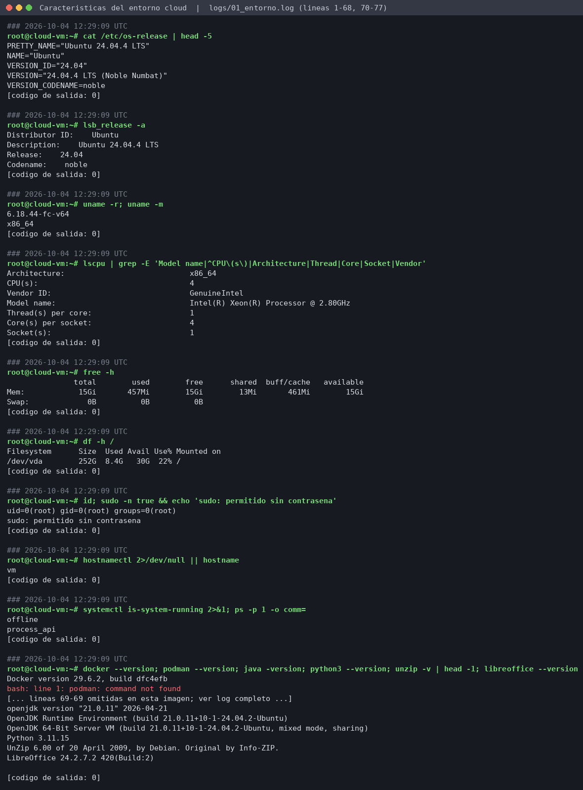

**Figura 1.** Características del entorno utilizado

En la Figura 1 se observa la salida de los comandos de identificación de la máquina cloud: `cat /etc/os-release`, `lsb_release -a`, `uname`, `lscpu`, `free -h`, `df -h`, `id`, `systemctl` y la verificación de herramientas instaladas. Estos comandos sirven para conocer, antes de instalar, si el equipo reúne las condiciones mínimas de Oracle. Como resultado se confirmó un sistema Ubuntu 24.04.4 LTS de 64 bits con 4 CPU, 15 GiB de RAM, 30 GB libres y permisos de administrador, recursos suficientes para la edición gratuita de Oracle. También se detectó que Docker estaba instalado pero sin el servicio en ejecución y que Podman no existía. Se omitió de la imagen una línea técnica de configuración del proxy de Java (`Picked up JAVA_TOOL_OPTIONS`), que puede consultarse en el log completo.

## 5. Instalación de Oracle Database

### 5.1 Selección de la edición y del método de instalación

Se evaluaron las dos ediciones gratuitas indicadas: **Oracle Database Express Edition (XE) 21c** y **Oracle Database Free**. Se eligió **Oracle Database Free** por ser la edición gratuita vigente y sucesora de XE. En cuanto al método, la instalación nativa mediante RPM está soportada por Oracle en Oracle Linux y Red Hat Enterprise Linux, no en Ubuntu, y el entorno no tiene systemd para administrar el servicio; por esas razones se decidió instalar Oracle **en un contenedor**, alternativa que el propio fabricante contempla para entornos de desarrollo.

### 5.2 Paso 1 – Preparación del sistema

Como el sistema no cuenta con systemd, el servicio de Docker no estaba iniciado (no existía el socket `/var/run/docker.sock`). Se inició manualmente el *daemon* con `dockerd` y se verificó con `docker info`. Además, para poder ejecutar la interfaz gráfica de SQL Developer en una máquina sin pantalla, se instalaron un servidor gráfico virtual (Xvfb, ya disponible), el gestor de ventanas `openbox`, `x11-utils` y `xdotool`.

*Extracto literal de `logs/02_preparacion.log` (líneas 8–19):*

```text
### 2026-10-04 12:29:20 UTC
root@cloud-vm:~# docker info 2>&1 | grep -E 'Server Version|Storage Driver|Cgroup|Kernel Version|Operating System|Total Memory|CPUs|Docker Root Dir'
 Server Version: 29.6.2
 Storage Driver: overlayfs
 Cgroup Driver: cgroupfs
 Cgroup Version: 1
 Kernel Version: 6.18.44-fc-v64
 Operating System: Ubuntu 24.04.4 LTS
 CPUs: 4
 Total Memory: 15.72GiB
 Docker Root Dir: /var/lib/docker
[codigo de salida: 0]
```

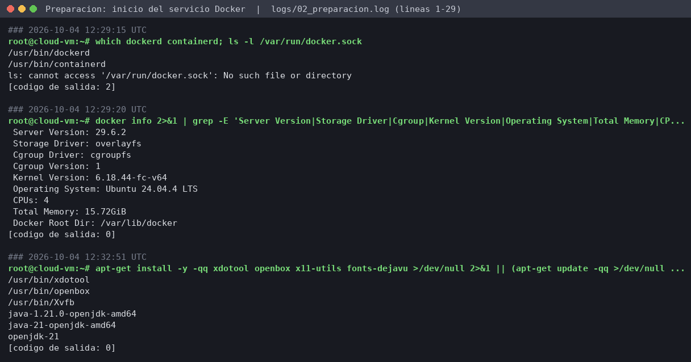

**Figura 2.** Preparación del sistema: inicio del servicio Docker

La Figura 2 muestra que inicialmente el socket de Docker no existía (código de salida 2) y que, después de iniciar `dockerd`, el comando `docker info` respondió con la versión del servidor 29.6.2, el controlador de almacenamiento `overlayfs`, 4 CPU y 15.72 GiB de memoria visibles para los contenedores. También se observa la instalación de las utilidades gráficas y la presencia de OpenJDK 21, requerido por SQL Developer. Con este paso el sistema quedó preparado para descargar e instalar Oracle.

### 5.3 Paso 2 – Dependencias

Al usar un contenedor, las dependencias del sistema operativo que Oracle necesita (bibliotecas, paquete *preinstall*, usuario `oracle` con UID 54321, parámetros del kernel del contenedor) vienen incluidas en la imagen, por lo que el host solo requiere Docker. Para las herramientas cliente se usó el JDK 21 ya instalado; para el cliente de red de prueba se instaló el paquete de Python `oracledb` (modo *thin*, sin Instant Client).

### 5.4 Paso 3 – Descarga

Primero se intentó la descarga oficial desde el sitio de Oracle, tanto del RPM de Oracle Database Free como del de XE 21c, y desde el registro oficial de contenedores. El servidor `download.oracle.com` respondió con una redirección (HTTP 302) hacia `edelivery.oracle.com`, y el proxy de red del entorno cloud **bloqueó** ese destino con HTTP 403; lo mismo ocurrió con `container-registry.oracle.com`. Este es un límite del entorno, no de Oracle, y se documentó tal como ocurrió:

*Extracto literal de `logs/03_descarga.log` (líneas 1–23):*

```text
### 2026-10-04 12:29:45 UTC
root@cloud-vm:~# curl -sSIL --max-time 30 https://download.oracle.com/otn-pub/otn_software/db-free/oracle-database-free-23ai-1.0-1.el8.x86_64.rpm 2>&1 | grep -iE 'HTTP/|location|curl'
curl: (56) CONNECT tunnel failed, response 403
HTTP/1.1 200 Connection Established
HTTP/1.1 302 Moved Temporarily
Location: https://edelivery.oracle.com/otn-pub/otn_software/db-free/oracle-database-free-23ai-1.0-1.el8.x86_64.rpm
HTTP/1.1 403 Forbidden
[codigo de salida: 0]

### 2026-10-04 12:29:46 UTC
root@cloud-vm:~# curl -sSIL --max-time 30 https://download.oracle.com/otn-pub/otn_software/db-express/oracle-database-xe-21c-1.0-1.ol8.x86_64.rpm 2>&1 | grep -iE 'HTTP/|location|curl'
curl: (56) CONNECT tunnel failed, response 403
HTTP/1.1 200 Connection Established
HTTP/1.1 302 Moved Temporarily
Location: https://edelivery.oracle.com/otn-pub/otn_software/db-express/oracle-database-xe-21c-1.0-1.ol8.x86_64.rpm
HTTP/1.1 403 Forbidden
[codigo de salida: 0]

### 2026-10-04 12:29:46 UTC
root@cloud-vm:~# curl -sS -o /dev/null -w 'HTTP %{http_code}\n' --max-time 20 https://container-registry.oracle.com/v2/
curl: (56) CONNECT tunnel failed, response 403
HTTP 000
[codigo de salida: 56]
```

Como alternativa razonable se descargó desde Docker Hub la imagen `gvenzl/oracle-free:23-slim`, del proyecto de código abierto *oci-oracle-free* (autor Gerald Venzl, según las etiquetas de la imagen), que contiene el motor Oracle Database Free listo para ejecutarse. La descarga tardó 35,7 segundos y la imagen ocupa 2,84 GB en disco.

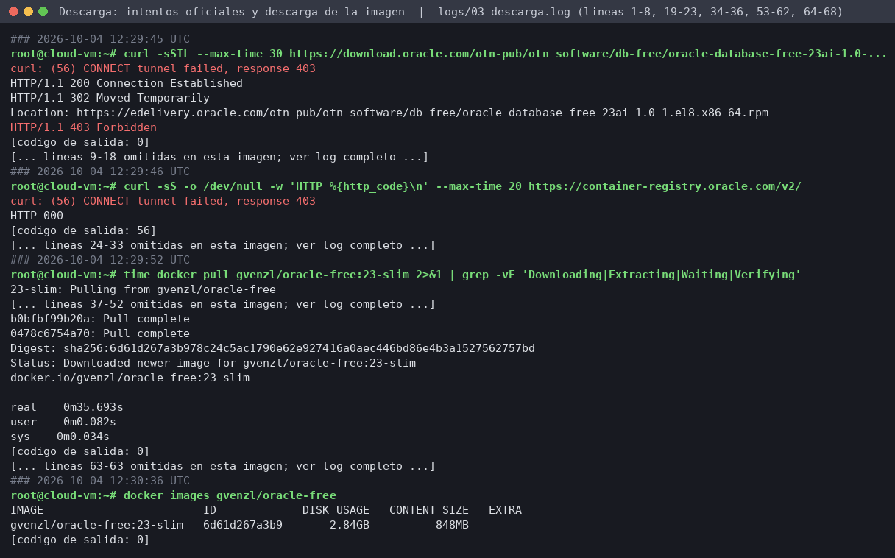

**Figura 3.** Descarga de Oracle Database Free

En la Figura 3 se observan, en rojo, los intentos de descarga oficiales rechazados con `403 Forbidden` por la política de red del entorno, y a continuación el comando `docker pull gvenzl/oracle-free:23-slim`, cuyas capas se descargaron completamente (`Pull complete`) con el resumen `sha256:6d61d267…` y el mensaje `Downloaded newer image`. Finalmente `docker images` confirma la imagen disponible localmente. La inspección de la imagen (log completo) muestra que el directorio de instalación es `/opt/oracle/product/26ai/dbhomeFree` y el SID es `FREE`.

En este mismo paso se descargaron desde `download.oracle.com` (este enlace sí estaba permitido) las herramientas cliente: **SQLcl 26.3** (123,9 MB) y **Oracle SQL Developer 24.3.1** sin JRE (587,6 MB). Sus sumas SHA-256 quedaron registradas en `logs/03_descarga.log`.

### 5.5 Paso 4 – Instalación

La instalación consistió en crear un volumen persistente para los archivos de datos y un contenedor a partir de la imagen. El parámetro `-p 1521:1521` publica el puerto del *listener* de Oracle en el host, `-v oracle_free_data:/opt/oracle/oradata` guarda los archivos de datos fuera del contenedor para que no se pierdan al reiniciarlo, y `-e ORACLE_PASSWORD=...` define la contraseña administrativa.

```bash
docker volume create oracle_free_data
docker run -d --name oracle-free -p 1521:1521 \
  -e ORACLE_PASSWORD=Sena2026Oracle \
  -v oracle_free_data:/opt/oracle/oradata \
  gvenzl/oracle-free:23-slim
```

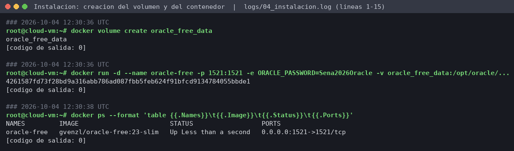

**Figura 4.** Instalación: creación del volumen y del contenedor Oracle

La Figura 4 muestra la creación del volumen `oracle_free_data`, la ejecución de `docker run`, que devolvió el identificador del contenedor `4261587fd73f…`, y el comando `docker ps`, donde el contenedor `oracle-free` aparece en estado `Up` con el puerto `0.0.0.0:1521->1521/tcp` publicado. Con esto el software de Oracle quedó instalado y en proceso de arranque.

## 6. Configuración de Oracle

### 6.1 Paso 5 – Configuración inicial de la base de datos

En el primer arranque, el contenedor descomprime los archivos de datos (22 segundos), inicia el *listener*, levanta la instancia `FREE`, monta y abre la base de datos contenedora (CDB) y la base de datos conectable (PDB) `FREEPDB1`. La memoria SGA asignada fue de 1.603.398.928 bytes (≈1,5 GB), dentro del límite de la edición Free.

### 6.2 Paso 6 – Contraseña administrativa

La contraseña indicada en `ORACLE_PASSWORD` se aplicó a las cuentas administrativas **SYS** y **SYSTEM**, lo cual se evidencia en el mensaje `CONTAINER: Resetting SYS and SYSTEM passwords` seguido de dos `User altered`. Se usó la contraseña académica `Sena2026Oracle`, válida únicamente para este entorno de práctica; en un ambiente real debería ser más robusta y no quedar escrita en comandos ni registros.

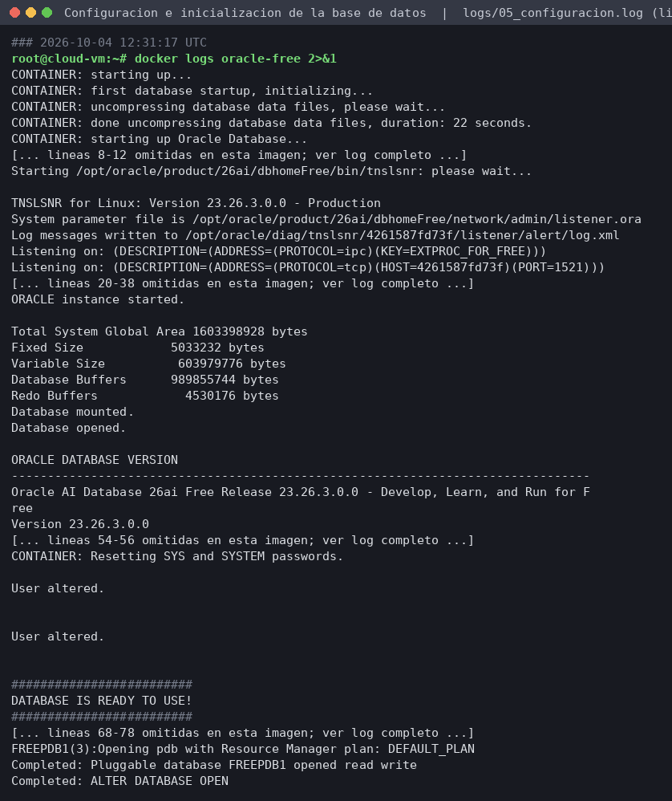

**Figura 5.** Configuración de Oracle: inicialización y contraseña administrativa

En la Figura 5 se observa el registro de arranque obtenido con `docker logs oracle-free`: la descompresión de los datos, el inicio del *listener* en el puerto 1521, los mensajes `ORACLE instance started`, `Database mounted` y `Database opened`, la versión **Oracle AI Database 26ai Free Release 23.26.3.0.0**, el cambio de contraseña de SYS y SYSTEM y el mensaje final **DATABASE IS READY TO USE!**. Al final aparece `Completed: Pluggable database FREEPDB1 opened read write`, que confirma que la base de datos conectable donde se trabajará quedó abierta en lectura y escritura.

### 6.3 Instalación y configuración de las herramientas cliente

Se descomprimieron SQLcl y SQL Developer en `/opt/oracle-tools`. Para SQL Developer se configuró el JDK en el archivo `~/.sqldeveloper/24.3.1/product.conf` (`SetJavaHome /usr/lib/jvm/java-21-openjdk-amd64`) y se ejecutó dentro de un servidor gráfico virtual Xvfb de 1600×1000 píxeles. Al iniciar, se respondió **No** a la importación de preferencias y se **desmarcó** el envío automático de estadísticas de uso a Oracle, tal como indica la guía para la evidencia EV01.

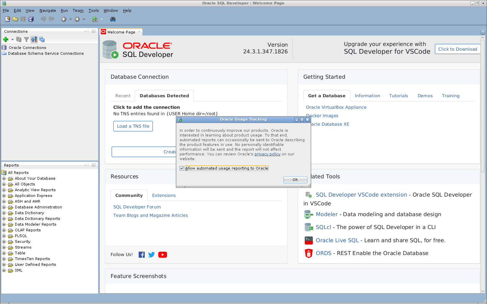

**Figura 6.** Oracle SQL Developer 24.3.1 en ejecución

La Figura 6 es una captura de pantalla real de la interfaz gráfica de Oracle SQL Developer versión 24.3.1.347.1826 ejecutándose en el display virtual de la máquina cloud. Se observa la página de bienvenida y el cuadro "Oracle Usage Tracking" previo a ser desmarcado. Esta herramienta es la que la guía indica para crear y administrar la base de datos; su ejecución correcta demuestra que el cliente gráfico quedó instalado.

## 7. Verificación de la instalación

### 7.1 Paso 7 y 8 – Inicio del servicio y comprobación de procesos

Se verificó que el contenedor siguiera en ejecución y que existieran los procesos en segundo plano esenciales de Oracle: **PMON** (monitor de procesos), **SMON** (monitor del sistema), **DBW0** (escritor de la base de datos), **LGWR** (escritor del registro de rehacer), **CKPT** (punto de control), **RECO** (recuperación de transacciones distribuidas) y **MMON** (monitor de gestión), además del *listener* `tnslsnr`.

### 7.2 Paso 9 – Comprobación de puertos

Se consultó el estado del *listener* con `lsnrctl status`, se probó la apertura del puerto 1521 desde el host y se listaron los puertos en escucha con `ss -ltnp`.

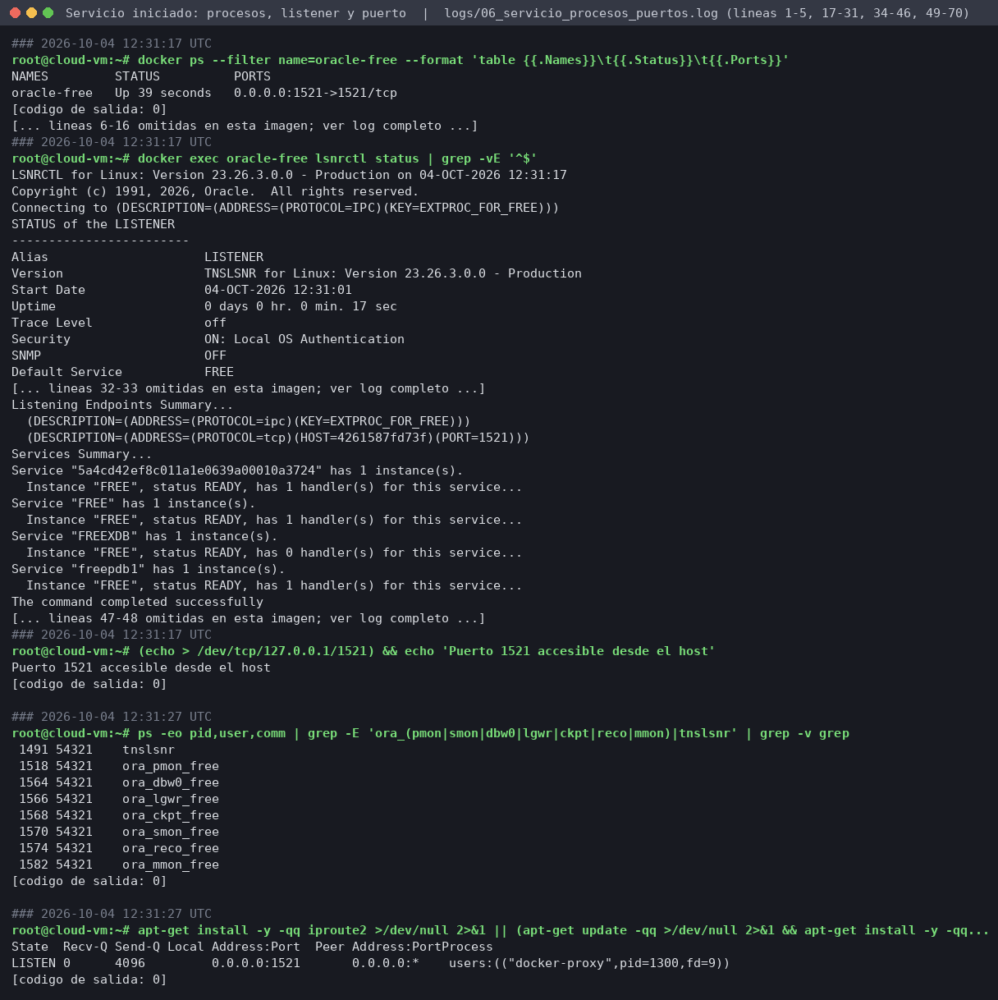

**Figura 7.** Oracle iniciado: procesos, listener y puerto 1521

En la Figura 7 se observa el contenedor en estado `Up`, la salida de `lsnrctl status` con el *listener* versión 23.26.3.0.0 escuchando por TCP en el puerto 1521 y los servicios `FREE` y `freepdb1` en estado `READY`; luego la prueba de conexión al puerto 1521 desde el host ("Puerto 1521 accesible desde el host"), la lista de procesos `ora_pmon_free`, `ora_smon_free`, `ora_dbw0_free`, `ora_lgwr_free`, `ora_ckpt_free`, `ora_reco_free`, `ora_mmon_free` y `tnslsnr` (propiedad del usuario 54321, que corresponde a `oracle`) y, por último, `ss -ltnp` mostrando el puerto 1521 en estado `LISTEN`. El resultado confirma que el servicio de base de datos está iniciado y accesible.

### 7.3 Paso 10 – Comprobación de la versión de Oracle

Se consultaron las vistas dinámicas `V$VERSION`, `V$INSTANCE`, `V$DATABASE` y `V$PDBS` conectándose como SYSDBA con SQL*Plus dentro del contenedor.

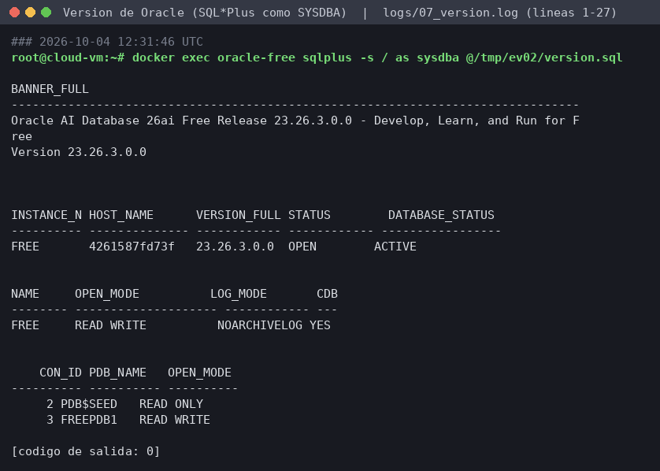

**Figura 8.** Versión de Oracle consultada con SQL*Plus

La Figura 8 muestra que la versión instalada es **Oracle AI Database 26ai Free Release 23.26.3.0.0** (la versión 23.26 es la que Oracle publica con la denominación "26ai", sucesora de "23ai"); la instancia `FREE` está en estado `OPEN`/`ACTIVE`; la base de datos `FREE` está abierta en `READ WRITE`, en modo `NOARCHIVELOG` y es contenedora (`CDB = YES`); y existen las PDB `PDB$SEED` (solo lectura) y `FREEPDB1` (lectura y escritura).

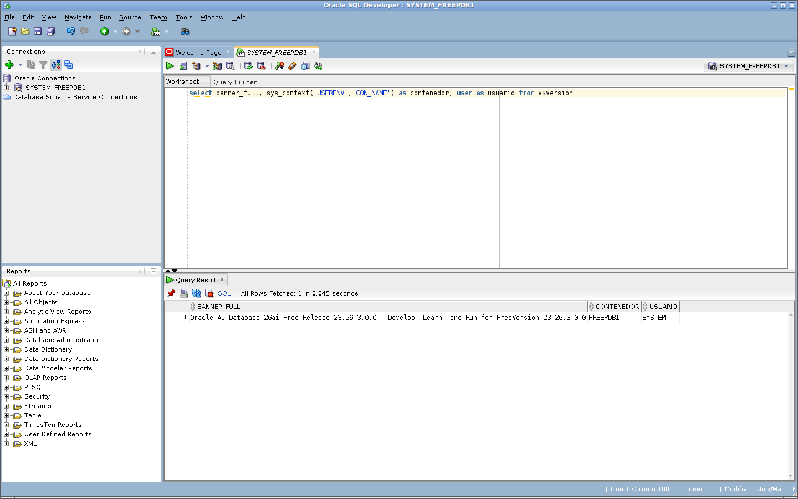

**Figura 9.** Versión de Oracle consultada desde SQL Developer

La Figura 9 es una captura de pantalla real de SQL Developer conectado como SYSTEM, donde en la hoja de trabajo (*Worksheet*) se ejecutó `select banner_full, sys_context('USERENV','CON_NAME') as contenedor, user as usuario from v$version` con Ctrl+Enter. El resultado (1 fila en 0,045 segundos) confirma la misma versión 23.26.3.0.0, el contenedor `FREEPDB1` y el usuario `SYSTEM`, lo que demuestra que la herramienta gráfica se comunica correctamente con el motor.

## 8. Conexión y pruebas

### 8.1 Paso 11 – Primera conexión SQL

La conexión se configuró en SQL Developer con el botón **New Connection** (signo + verde) y los siguientes datos:

**Tabla 3.** Parámetros de conexión utilizados

| Parámetro | Conexión administrativa | Conexión del caso de estudio |
|---|---|---|
| Nombre de la conexión | SYSTEM_FREEPDB1 | TECH_TRANSITION |
| Usuario | system | tech_transition |
| Contraseña | Sena2026Oracle (académica) | TechT2026 (académica) |
| Host | localhost | localhost |
| Puerto | 1521 | 1521 |
| Nombre de servicio | FREEPDB1 | FREEPDB1 |

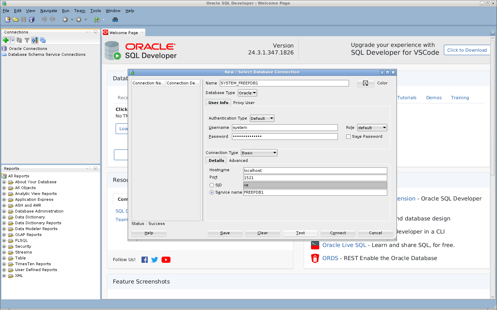

**Figura 10.** Conexión SQL desde SQL Developer (prueba exitosa)

En la Figura 10, captura real de SQL Developer, se observa el cuadro "New / Select Database Connection" diligenciado con el nombre `SYSTEM_FREEPDB1`, el usuario `system`, la contraseña (oculta), el host `localhost`, el puerto `1521` y el nombre de servicio `FREEPDB1`. Al presionar **Test**, la parte inferior del cuadro muestra **Status : Success**, es decir, la conexión fue validada por el servidor. Luego se presionó **Connect** y se abrió la hoja de trabajo.

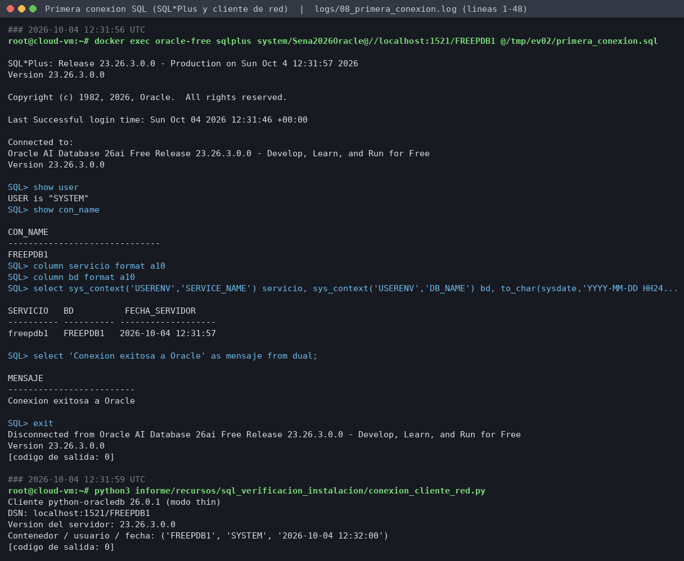

**Figura 11.** Primera conexión SQL con SQL*Plus y con un cliente de red

La Figura 11 complementa la prueba: con SQL*Plus se ejecutaron `show user`, `show con_name` y dos consultas sobre `DUAL`, obteniendo el usuario `SYSTEM`, el contenedor `FREEPDB1`, la fecha del servidor y el mensaje "Conexion exitosa a Oracle". Después, desde el host y por red TCP, el script `conexion_cliente_red.py` (biblioteca `python-oracledb` 26.0.1 en modo *thin*) se conectó a `localhost:1521/FREEPDB1` y reportó la versión del servidor 23.26.3.0.0. Así se comprobó que Oracle acepta conexiones tanto locales como remotas a través del puerto publicado.

## 9. Caso de estudio TECH TRANSITION

**Contexto.** La empresa TECH TRANSITION comercializa equipos de cómputo, periféricos, redes y servicios técnicos en tres sucursales (Bogotá, Medellín y Cali). El aprendiz fue seleccionado para crear una solución de datos (base para una bodega de datos) en el **departamento de facturación**. Según la guía, toda la información del caso debe ser creada por el aprendiz; por ello **todos los datos utilizados son ficticios**: nombres, documentos, teléfonos y correos inventados (los correos usan el dominio reservado `example.com`), sin datos personales reales.

**Situación supuesta.** Para el análisis se planteó como escenario que la facturación se llevaba en hojas de cálculo independientes por sucursal, con los datos del cliente y de los artículos repetidos en cada fila de factura. Esta situación genera duplicidad, errores de digitación, dificultad para calcular saldos y riesgo de pérdida de información, que es justamente lo que la reflexión inicial de la guía advierte.

**Lo que se debe entregar (según la guía):**

1. Una lista de chequeo con los requerimientos que se deben solucionar.
2. La verificación de si la información está recopilada y organizada (información creada por el aprendiz).
3. Una base de datos en Oracle creada por medio de SQL Developer.
4. Las tablas requeridas con sus columnas, tipos de datos y relaciones para: número de factura, fecha de factura, fecha de vencimiento, cliente, sucursal, valor total, forma de pago, valor pagado, artículo, cantidad y valor unitario.
5. La conclusión de lo realizado.

## 10. Lista de chequeo

La lista de chequeo se diligenció al final de la práctica con base en las evidencias reales obtenidas (logs y capturas).

**Tabla 4.** Lista de chequeo de requerimientos del caso TECH TRANSITION

| N.º | Requerimiento | Cumple | No cumple | Observaciones |
|---|---|:---:|:---:|---|
| 1 | Motor Oracle instalado | X | | Oracle AI Database 26ai Free 23.26.3.0.0 en contenedor Docker (Figuras 3 a 5). |
| 2 | Servicio iniciado | X | | Instancia `FREE` OPEN/ACTIVE, procesos PMON/SMON/LGWR activos, listener en 1521 (Figura 7). |
| 3 | Contraseña administrativa configurada | X | | Aplicada a SYS y SYSTEM (Figura 5). |
| 4 | Herramienta SQL Developer instalada | X | | Versión 24.3.1 ejecutada en display virtual (Figura 6). |
| 5 | Usuario/esquema creado | X | | `TECH_TRANSITION` con cuota de 200 MB y 5 privilegios (Figura 13). |
| 6 | Conexión funcionando | X | | SYSTEM y TECH_TRANSITION: *Status: Success* en SQL Developer; SQL*Plus, SQLcl y python-oracledb (Figuras 10, 11 y 14). |
| 7 | Información de clientes | X | | Tabla CLIENTES con 10 registros ficticios. |
| 8 | Información de sucursales | X | | Tabla SUCURSALES con 3 registros. |
| 9 | Información de facturas | X | | Tabla FACTURAS con 20 registros (número, fechas, cliente, sucursal, forma de pago, valor total y pagado). |
| 10 | Información de artículos | X | | Tabla ARTICULOS con 15 registros. |
| 11 | Información de formas de pago | X | | Tabla FORMAS_PAGO con 6 registros (se pedían mínimo 5). |
| 12 | Detalle de factura (artículo, cantidad, valor unitario) | X | | Tabla DETALLE_FACTURA con 52 líneas; subtotal como columna virtual. |
| 13 | Integridad de datos | X | | 6 PK, 5 UNIQUE, 10 CHECK y 32 NOT NULL; 7 pruebas de violación rechazadas (Figuras 24 y 25). |
| 14 | Relaciones entre tablas | X | | 5 claves foráneas verificadas en el diccionario y en el modelo de SQL Developer (Figuras 18 y 19). |
| 15 | Datos de prueba | X | | 106 registros insertados con `COMMIT`. |
| 16 | Consultas de validación | X | | 10 consultas solicitadas más una adicional (saldo por cliente) (Figuras 20 a 22). |
| 17 | Consistencia de totales | X | | Valor total de cada factura = suma de su detalle (0 inconsistencias). |
| 18 | Persistencia después de reiniciar el servicio | X | | Datos intactos tras `docker stop`/`docker start` (Figura 26). |
| 19 | Instalación nativa desde el instalador oficial de Oracle | | X | No fue posible: la red del entorno bloquea `edelivery.oracle.com` y `container-registry.oracle.com` (HTTP 403). Se usó una imagen de contenedor de Docker Hub (sección 5.4). |

## 11. Análisis de requerimientos

### 11.1 Verificación de la información (¿está recopilada y organizada?)

Al revisar el escenario planteado se concluyó que la información **no estaba organizada** para ser administrada en una base de datos: los datos del cliente se repetían en cada factura, no existía un catálogo único de artículos ni de formas de pago, el número de factura no era controlado como identificador único y el saldo pendiente se calculaba manualmente. Por lo tanto, se **creó** la información necesaria y se organizó en entidades independientes, como se resume en la Tabla 5.

**Tabla 5.** Organización de la información requerida

| Dato exigido por la guía | Entidad donde se almacena | Columna | Observación |
|---|---|---|---|
| Número de factura | FACTURAS | `numero_factura` | Clave primaria |
| Fecha de factura | FACTURAS | `fecha_factura` | Tipo DATE |
| Fecha de vencimiento | FACTURAS | `fecha_vencimiento` | Debe ser ≥ fecha de factura |
| Cliente | CLIENTES (relacionada con FACTURAS) | `id_cliente` | Clave foránea |
| Sucursal | SUCURSALES (relacionada con FACTURAS) | `id_sucursal` | Clave foránea |
| Valor total | FACTURAS | `valor_total` | Suma de los subtotales del detalle |
| Forma de pago | FORMAS_PAGO (relacionada con FACTURAS) | `id_forma_pago` | Clave foránea |
| Valor pagado | FACTURAS | `valor_pagado` | Entre 0 y el valor total |
| Artículo | ARTICULOS (relacionada con DETALLE_FACTURA) | `id_articulo` | Clave foránea |
| Cantidad | DETALLE_FACTURA | `cantidad` | Mayor que 0 |
| Valor unitario | DETALLE_FACTURA | `valor_unitario` | Valor aplicado en la venta |

### 11.2 Requerimientos funcionales

- **RF1.** Registrar clientes con tipo y número de documento únicos.
- **RF2.** Registrar sucursales, formas de pago (con días de plazo) y artículos con su precio.
- **RF3.** Registrar facturas con número, fecha, vencimiento, cliente, sucursal y forma de pago.
- **RF4.** Registrar el detalle de cada factura (artículo, cantidad y valor unitario) y calcular el subtotal.
- **RF5.** Calcular el valor total de la factura y registrar el valor pagado.
- **RF6.** Consultar facturación por cliente, sucursal y forma de pago; saldos pendientes y artículos más vendidos.

### 11.3 Requerimientos no funcionales

- **RNF1. Integridad:** impedir registros huérfanos, duplicados o con valores inválidos mediante restricciones del motor.
- **RNF2. Normalización:** evitar redundancia (tercera forma normal).
- **RNF3. Seguridad:** usar un usuario propio del esquema con privilegios mínimos, no el usuario SYSTEM.
- **RNF4. Persistencia:** los datos deben sobrevivir a reinicios del servicio.
- **RNF5. Trazabilidad:** todo el proceso queda documentado en scripts y logs reproducibles.

## 12. Diseño de la base de datos

Se descartó una tabla plana única porque repetiría los datos del cliente, de la sucursal y del artículo en cada línea vendida. El modelo se normalizó hasta la **tercera forma normal (3FN)**: cuatro tablas maestras (CLIENTES, SUCURSALES, FORMAS_PAGO, ARTICULOS), una tabla de encabezado (FACTURAS) y una tabla de detalle (DETALLE_FACTURA) que resuelve la relación muchos a muchos entre facturas y artículos.

Decisiones de diseño relevantes:

- Los importes usan `NUMBER(p,2)` para manejar pesos colombianos con dos decimales sin errores de redondeo de punto flotante.
- `DETALLE_FACTURA.subtotal` es una **columna virtual** (`GENERATED ALWAYS AS (cantidad * valor_unitario)`), por lo que nunca puede quedar desactualizada.
- `DETALLE_FACTURA` guarda su propio `valor_unitario` para conservar el precio histórico aunque cambie el precio de lista del artículo.
- La clave primaria del detalle es compuesta (`numero_factura`, `numero_linea`) y un índice único impide repetir el mismo artículo dentro de una factura.
- `FK_DETALLE_FACTURAS` usa `ON DELETE CASCADE` (el detalle no existe sin su factura); las demás claves foráneas usan la regla por defecto (`NO ACTION`), que impide borrar un cliente, sucursal, forma de pago o artículo que tenga movimientos.
- Se crearon índices sobre las claves foráneas y la fecha de factura para acelerar los JOIN y las consultas por período.

**Modelo relacional en notación Mermaid** (archivo `informe/recursos/modelo_relacional.mmd`):

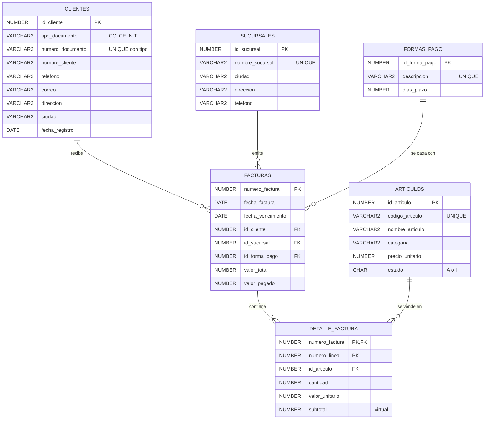

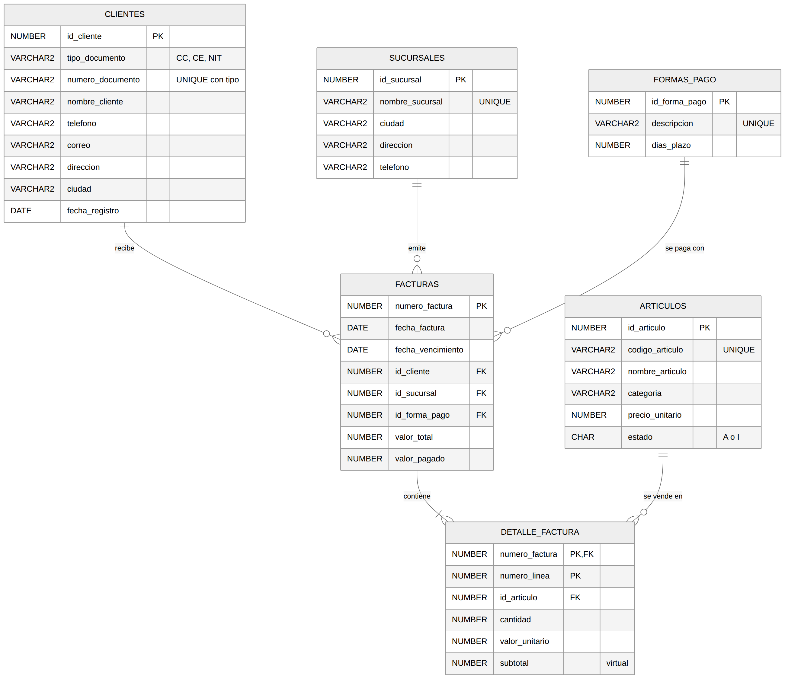

**Figura 12.** Modelo entidad-relación de la base de datos de facturación

La Figura 12 es el diagrama generado a partir del código Mermaid anterior. Se observan las seis entidades con sus columnas y tipos de datos, y las relaciones: un cliente recibe cero o muchas facturas; una sucursal emite cero o muchas facturas; una forma de pago se usa en cero o muchas facturas; una factura contiene una o muchas líneas de detalle; y un artículo se vende en cero o muchas líneas de detalle. La notación de "pata de gallo" indica la cardinalidad "muchos" y el círculo indica que la relación es opcional en ese extremo.

**Diagrama textual del modelo:**

```text
CLIENTES (1) ────< (N) FACTURAS (1) ────< (N) DETALLE_FACTURA (N) >──── (1) ARTICULOS
SUCURSALES (1) ──< (N) FACTURAS
FORMAS_PAGO (1) ─< (N) FACTURAS
```

## 13. Diccionario de datos

El siguiente diccionario se **extrajo directamente de Oracle** (vistas `USER_TAB_COLS`, `USER_COL_COMMENTS`, `USER_CONSTRAINTS` y `USER_CONS_COLUMNS`) con el script `informe/recursos/diccionario_datos.sql`; el archivo completo está en `resultados/diccionario_datos.csv`. Las descripciones provienen de los comentarios (`COMMENT ON`) definidos en el script de creación. En la columna Longitud, para `NUMBER` se indica precisión y escala.

**Tabla 6.** Diccionario de datos – CLIENTES

| Tabla | Columna | Descripción | Tipo de dato | Longitud | Permite NULL | PK | FK | Tabla relacionada |
|---|---|---|---|---|:---:|:---:|:---:|---|
| CLIENTES | ID_CLIENTE | Identificador interno del cliente | NUMBER | 6 | NO | SI | NO | - |
| CLIENTES | TIPO_DOCUMENTO | Tipo de documento: CC, CE o NIT | VARCHAR2 | 3 | NO | NO | NO | - |
| CLIENTES | NUMERO_DOCUMENTO | Numero del documento de identificacion | VARCHAR2 | 15 | NO | NO | NO | - |
| CLIENTES | NOMBRE_CLIENTE | Nombre o razon social del cliente | VARCHAR2 | 100 | NO | NO | NO | - |
| CLIENTES | TELEFONO | Telefono de contacto | VARCHAR2 | 15 | SI | NO | NO | - |
| CLIENTES | CORREO | Correo electronico para envio de facturas | VARCHAR2 | 100 | SI | NO | NO | - |
| CLIENTES | DIRECCION | Direccion del cliente | VARCHAR2 | 120 | SI | NO | NO | - |
| CLIENTES | CIUDAD | Ciudad del cliente | VARCHAR2 | 50 | NO | NO | NO | - |
| CLIENTES | FECHA_REGISTRO | Fecha de registro del cliente | DATE | - | NO | NO | NO | - |

**Tabla 7.** Diccionario de datos – SUCURSALES

| Tabla | Columna | Descripción | Tipo de dato | Longitud | Permite NULL | PK | FK | Tabla relacionada |
|---|---|---|---|---|:---:|:---:|:---:|---|
| SUCURSALES | ID_SUCURSAL | Identificador de la sucursal | NUMBER | 4 | NO | SI | NO | - |
| SUCURSALES | NOMBRE_SUCURSAL | Nombre de la sucursal | VARCHAR2 | 60 | NO | NO | NO | - |
| SUCURSALES | CIUDAD | Ciudad donde opera la sucursal | VARCHAR2 | 50 | NO | NO | NO | - |
| SUCURSALES | DIRECCION | Direccion de la sucursal | VARCHAR2 | 120 | NO | NO | NO | - |
| SUCURSALES | TELEFONO | Telefono de la sucursal | VARCHAR2 | 15 | SI | NO | NO | - |

**Tabla 8.** Diccionario de datos – FORMAS_PAGO

| Tabla | Columna | Descripción | Tipo de dato | Longitud | Permite NULL | PK | FK | Tabla relacionada |
|---|---|---|---|---|:---:|:---:|:---:|---|
| FORMAS_PAGO | ID_FORMA_PAGO | Identificador de la forma de pago | NUMBER | 2 | NO | SI | NO | - |
| FORMAS_PAGO | DESCRIPCION | Nombre de la forma de pago | VARCHAR2 | 40 | NO | NO | NO | - |
| FORMAS_PAGO | DIAS_PLAZO | Dias de plazo para el pago (0 = contado) | NUMBER | 3 | NO | NO | NO | - |

**Tabla 9.** Diccionario de datos – ARTICULOS

| Tabla | Columna | Descripción | Tipo de dato | Longitud | Permite NULL | PK | FK | Tabla relacionada |
|---|---|---|---|---|:---:|:---:|:---:|---|
| ARTICULOS | ID_ARTICULO | Identificador interno del articulo | NUMBER | 6 | NO | SI | NO | - |
| ARTICULOS | CODIGO_ARTICULO | Codigo comercial (SKU) del articulo | VARCHAR2 | 20 | NO | NO | NO | - |
| ARTICULOS | NOMBRE_ARTICULO | Descripcion del articulo | VARCHAR2 | 100 | NO | NO | NO | - |
| ARTICULOS | CATEGORIA | Categoria del articulo | VARCHAR2 | 40 | NO | NO | NO | - |
| ARTICULOS | PRECIO_UNITARIO | Precio de lista vigente en pesos colombianos | NUMBER | 12,2 | NO | NO | NO | - |
| ARTICULOS | ESTADO | A = activo, I = inactivo | CHAR | 1 | NO | NO | NO | - |

**Tabla 10.** Diccionario de datos – FACTURAS

| Tabla | Columna | Descripción | Tipo de dato | Longitud | Permite NULL | PK | FK | Tabla relacionada |
|---|---|---|---|---|:---:|:---:|:---:|---|
| FACTURAS | NUMERO_FACTURA | Numero consecutivo de la factura | NUMBER | 10 | NO | SI | NO | - |
| FACTURAS | FECHA_FACTURA | Fecha de expedicion de la factura | DATE | - | NO | NO | NO | - |
| FACTURAS | FECHA_VENCIMIENTO | Fecha limite de pago | DATE | - | NO | NO | NO | - |
| FACTURAS | ID_CLIENTE | Cliente facturado (FK a CLIENTES) | NUMBER | 6 | NO | NO | SI | CLIENTES |
| FACTURAS | ID_SUCURSAL | Sucursal que factura (FK a SUCURSALES) | NUMBER | 4 | NO | NO | SI | SUCURSALES |
| FACTURAS | ID_FORMA_PAGO | Forma de pago (FK a FORMAS_PAGO) | NUMBER | 2 | NO | NO | SI | FORMAS_PAGO |
| FACTURAS | VALOR_TOTAL | Valor total de la factura (suma de subtotales) | NUMBER | 14,2 | NO | NO | NO | - |
| FACTURAS | VALOR_PAGADO | Valor abonado por el cliente | NUMBER | 14,2 | NO | NO | NO | - |

**Tabla 11.** Diccionario de datos – DETALLE_FACTURA

| Tabla | Columna | Descripción | Tipo de dato | Longitud | Permite NULL | PK | FK | Tabla relacionada |
|---|---|---|---|---|:---:|:---:|:---:|---|
| DETALLE_FACTURA | NUMERO_FACTURA | Factura a la que pertenece la linea (FK a FACTURAS) | NUMBER | 10 | NO | SI | SI | FACTURAS |
| DETALLE_FACTURA | NUMERO_LINEA | Numero de linea dentro de la factura | NUMBER | 3 | NO | SI | NO | - |
| DETALLE_FACTURA | ID_ARTICULO | Articulo vendido (FK a ARTICULOS) | NUMBER | 6 | NO | NO | SI | ARTICULOS |
| DETALLE_FACTURA | CANTIDAD | Cantidad de unidades vendidas | NUMBER | 6 | NO | NO | NO | - |
| DETALLE_FACTURA | VALOR_UNITARIO | Valor unitario aplicado en la venta | NUMBER | 12,2 | NO | NO | NO | - |
| DETALLE_FACTURA | SUBTOTAL | Columna virtual: cantidad * valor_unitario | NUMBER | 14,2 | SI | NO | NO | - |

**Tabla 12.** Restricciones de integridad adicionales (CHECK y UNIQUE)

| Tabla | Restricción | Tipo | Regla |
|---|---|---|---|
| CLIENTES | `UQ_CLIENTES_DOCUMENTO` | UNIQUE | (tipo_documento, numero_documento) no se repite |
| CLIENTES | `CK_CLIENTES_TIPO_DOC` | CHECK | tipo_documento IN ('CC','CE','NIT') |
| CLIENTES | `CK_CLIENTES_CORREO` | CHECK | correo nulo o con formato `algo@algo.algo` |
| SUCURSALES | `UQ_SUCURSALES_NOMBRE` | UNIQUE | nombre de sucursal único |
| FORMAS_PAGO | `UQ_FORMAS_PAGO_DESC` | UNIQUE | descripción única |
| FORMAS_PAGO | `CK_FORMAS_PAGO_DIAS` | CHECK | dias_plazo entre 0 y 180 |
| ARTICULOS | `UQ_ARTICULOS_CODIGO` | UNIQUE | código de artículo único |
| ARTICULOS | `CK_ARTICULOS_PRECIO` | CHECK | precio_unitario > 0 |
| ARTICULOS | `CK_ARTICULOS_ESTADO` | CHECK | estado IN ('A','I') |
| FACTURAS | `CK_FACTURAS_FECHAS` | CHECK | fecha_vencimiento ≥ fecha_factura |
| FACTURAS | `CK_FACTURAS_TOTAL` | CHECK | valor_total ≥ 0 |
| FACTURAS | `CK_FACTURAS_PAGADO` | CHECK | 0 ≤ valor_pagado ≤ valor_total |
| DETALLE_FACTURA | `UQ_DETALLE_ARTICULO` | UNIQUE | un artículo una sola vez por factura |
| DETALLE_FACTURA | `CK_DETALLE_CANTIDAD` | CHECK | cantidad > 0 |
| DETALLE_FACTURA | `CK_DETALLE_VALOR` | CHECK | valor_unitario ≥ 0 |

## 14. Creación de las tablas

### 14.1 Creación del usuario/esquema TECH_TRANSITION

En Oracle, cada usuario es dueño de un esquema; por eso "crear la base de datos" del caso se traduce en crear un usuario propietario dentro de la PDB `FREEPDB1`. El script `sql/01_creacion_usuario.sql` se ejecutó como SYSTEM:

```sql
drop user if exists tech_transition cascade;
create user tech_transition identified by "TechT2026"
  default tablespace users temporary tablespace temp
  quota 200m on users;
grant create session, create table, create view,
      create sequence, create trigger to tech_transition;  -- (en el script, un GRANT por privilegio)
```

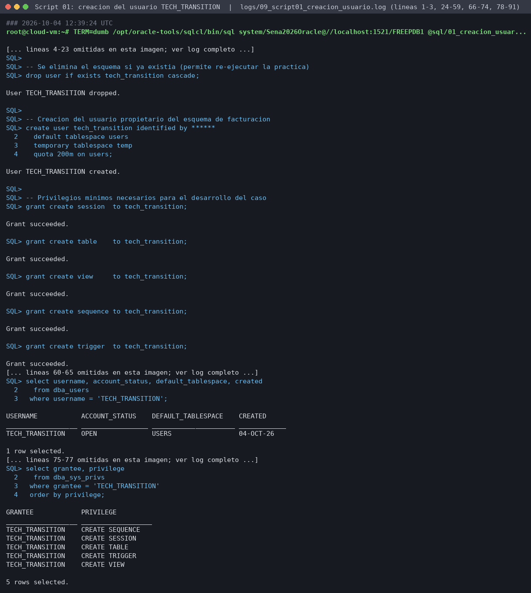

**Figura 13.** Creación del usuario TECH_TRANSITION

La Figura 13 muestra la ejecución del script con SQLcl: el `DROP USER IF EXISTS` (que permite repetir la práctica; Oracle responde `User dropped` aunque el usuario aún no existiera), el `CREATE USER` (SQLcl oculta la contraseña con asteriscos), los cinco `Grant succeeded` y las consultas de verificación a `DBA_USERS`, `DBA_SYS_PRIVS` y `DBA_TS_QUOTAS`: el usuario quedó en estado `OPEN`, con tablespace `USERS`, cinco privilegios de sistema y una cuota de 200 MB.

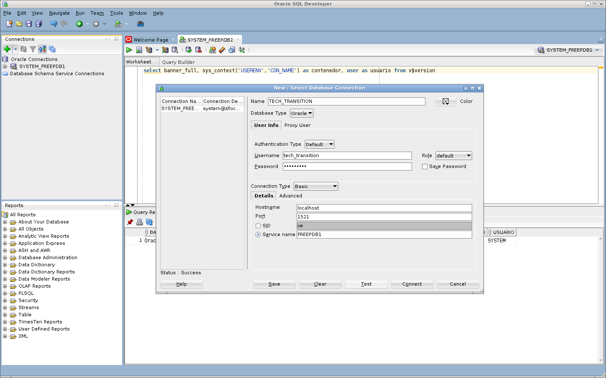

**Figura 14.** Conexión del usuario TECH_TRANSITION en SQL Developer

En la Figura 14, captura real de SQL Developer, se creó la conexión `TECH_TRANSITION` con el usuario `tech_transition`, servicio `FREEPDB1`, y la prueba devolvió **Status : Success**. Al fondo se ve la conexión `SYSTEM_FREEPDB1` creada anteriormente. Con esta conexión se trabajó el esquema del caso.

### 14.2 Creación de las tablas

El script `sql/02_creacion_tablas.sql` se ejecutó conectado como TECH_TRANSITION. Como fragmento representativo se presenta la tabla FACTURAS, que concentra la mayoría de los datos exigidos por la guía:

```sql
create table facturas (
  numero_factura     number(10)     not null,
  fecha_factura      date           not null,
  fecha_vencimiento  date           not null,
  id_cliente         number(6)      not null,
  id_sucursal        number(4)      not null,
  id_forma_pago      number(2)      not null,
  valor_total        number(14,2)   default 0 not null,
  valor_pagado       number(14,2)   default 0 not null,
  constraint pk_facturas primary key (numero_factura),
  constraint fk_facturas_clientes foreign key (id_cliente) references clientes (id_cliente),
  constraint fk_facturas_sucursales foreign key (id_sucursal) references sucursales (id_sucursal),
  constraint fk_facturas_formas_pago foreign key (id_forma_pago) references formas_pago (id_forma_pago),
  constraint ck_facturas_fechas check (fecha_vencimiento >= fecha_factura),
  constraint ck_facturas_total check (valor_total >= 0),
  constraint ck_facturas_pagado check (valor_pagado >= 0 and valor_pagado <= valor_total)
);
```

El script completo (Anexo A) crea las seis tablas en orden de dependencia (primero las maestras y luego las que tienen claves foráneas), cinco índices y 43 comentarios de tabla y columna.

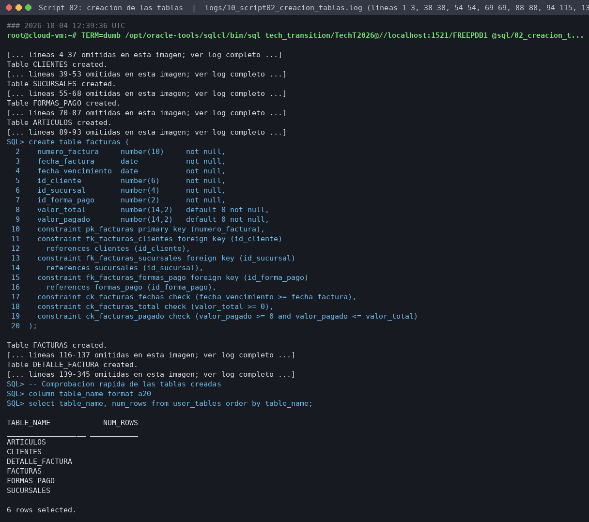

**Figura 15.** Creación de las tablas con el script 02

La Figura 15 presenta el extracto del log de ejecución: los mensajes `Table CLIENTES created`, `Table SUCURSALES created`, `Table FORMAS_PAGO created`, `Table ARTICULOS created`, la sentencia completa de `FACTURAS` con su mensaje de creación, `Table DETALLE_FACTURA created` y la consulta final a `USER_TABLES`, que lista las seis tablas. El log no registró ningún error.

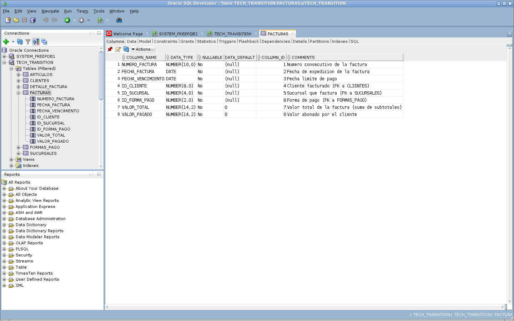

**Figura 16.** Tablas del esquema y columnas de FACTURAS en SQL Developer

En la Figura 16, captura real de SQL Developer, el árbol de la conexión `TECH_TRANSITION` muestra en *Tables* las seis tablas creadas y, a la derecha, la pestaña *Columns* de FACTURAS con el nombre, tipo de dato (`NUMBER(10,0)`, `DATE`, `NUMBER(14,2)`…), obligatoriedad (`Nullable = No`), valor por defecto (0 en los importes) y el comentario de cada columna. Esto confirma que la estructura definida en el script quedó registrada en el diccionario de Oracle.

## 15. Inserción de registros

El script `sql/03_insercion_datos.sql` carga los datos ficticios. Para garantizar coherencia, el SQL se generó con un pequeño programa determinista (`informe/recursos/generador_03_insercion_datos.py`) que calcula la fecha de vencimiento a partir de los días de plazo de la forma de pago; el resultado es un script SQL convencional. La carga sigue este orden:

1. Tablas maestras: 10 clientes, 3 sucursales, 6 formas de pago y 15 artículos, seguidas de `COMMIT`.
2. 20 facturas (de la 1001 a la 1020, entre julio y septiembre de 2026) con valor total y pagado en 0.
3. 52 líneas de detalle (de 2 a 4 artículos por factura).
4. Cálculo del valor total con un `UPDATE` correlacionado: `valor_total = SUM(subtotal)` del detalle.
5. Registro de pagos: pago total en 15 facturas, pago del 50 % en 3 facturas a crédito y sin pago en 2 facturas a crédito. `COMMIT` final.

```sql
update facturas f
   set valor_total = (select nvl(sum(d.subtotal), 0)
                        from detalle_factura d
                       where d.numero_factura = f.numero_factura);
update facturas set valor_pagado = round(valor_total * 0.5, 2)
 where numero_factura in (1009, 1011, 1018);
commit;
```

**Tabla 13.** Registros insertados (conteo obtenido en Oracle)

| Tabla | Mínimo solicitado | Registros insertados |
|---|---:|---:|
| CLIENTES | 10 | 10 |
| SUCURSALES | 3 | 3 |
| FORMAS_PAGO | 5 | 6 |
| ARTICULOS | 15 | 15 |
| FACTURAS | 20 | 20 |
| DETALLE_FACTURA | múltiples | 52 |
| **Total** | | **106** |

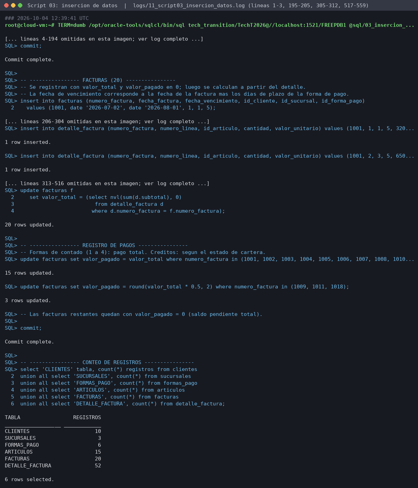

**Figura 17.** Inserción de datos y COMMIT

La Figura 17 muestra fragmentos del log del script 03: el `COMMIT` de las tablas maestras, la inserción de la primera factura (1001) y de sus líneas de detalle con el mensaje `1 row inserted`, el `UPDATE` que calculó el valor total de las 20 facturas (`20 rows updated`), los `UPDATE` de pagos (`15 rows updated` y `3 rows updated`), el `COMMIT` final y el conteo de registros por tabla (10, 3, 6, 15, 20 y 52). En total se ejecutaron 106 inserciones sin errores.

## 16. Relaciones entre las tablas

Las relaciones se implementaron con cinco claves foráneas:

**Tabla 14.** Relaciones implementadas

| Restricción | Tabla hija (columna) | Tabla padre | Cardinalidad | Regla al borrar |
|---|---|---|---|---|
| `FK_FACTURAS_CLIENTES` | FACTURAS (id_cliente) | CLIENTES | 1 : N | NO ACTION |
| `FK_FACTURAS_SUCURSALES` | FACTURAS (id_sucursal) | SUCURSALES | 1 : N | NO ACTION |
| `FK_FACTURAS_FORMAS_PAGO` | FACTURAS (id_forma_pago) | FORMAS_PAGO | 1 : N | NO ACTION |
| `FK_DETALLE_FACTURAS` | DETALLE_FACTURA (numero_factura) | FACTURAS | 1 : N | CASCADE |
| `FK_DETALLE_ARTICULOS` | DETALLE_FACTURA (id_articulo) | ARTICULOS | 1 : N | NO ACTION |

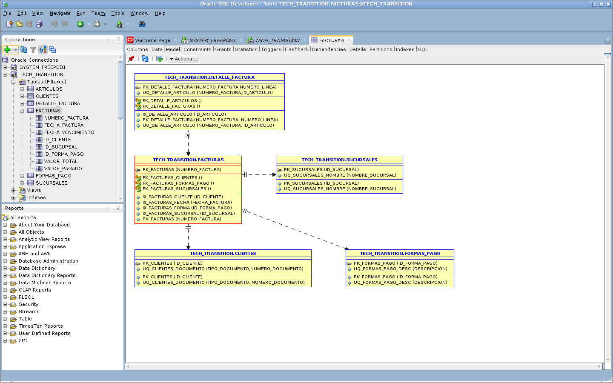

**Figura 18.** Modelo de relaciones de FACTURAS generado por SQL Developer

La Figura 18 es una captura real de la pestaña *Model* de la tabla FACTURAS en SQL Developer. La herramienta lee las claves foráneas del diccionario de Oracle y dibuja las tablas relacionadas: FACTURAS (en rojo, tabla seleccionada) con sus claves `FK_FACTURAS_CLIENTES`, `FK_FACTURAS_FORMAS_PAGO` y `FK_FACTURAS_SUCURSALES` apuntando a CLIENTES, FORMAS_PAGO y SUCURSALES, y DETALLE_FACTURA apuntando a FACTURAS mediante `FK_DETALLE_FACTURAS`. También se listan los índices de cada tabla. Esta vista confirma que las relaciones existen en el motor y no solo en el diseño.

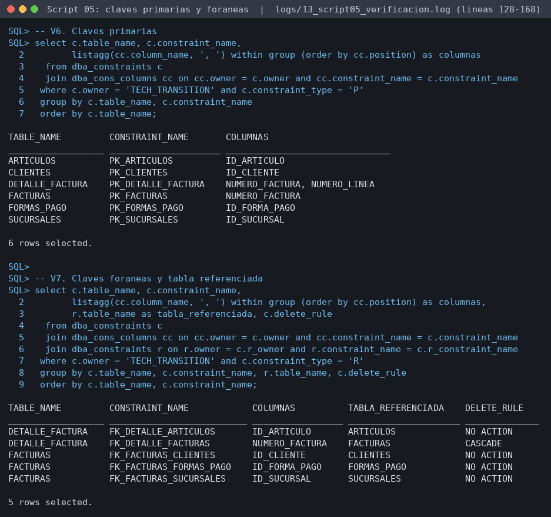

**Figura 19.** Claves primarias y foráneas consultadas en el diccionario de datos

La Figura 19 presenta las consultas V6 y V7 del script de verificación sobre `DBA_CONSTRAINTS` y `DBA_CONS_COLUMNS`: las seis claves primarias (incluida la compuesta `NUMERO_FACTURA, NUMERO_LINEA` de DETALLE_FACTURA) y las cinco claves foráneas con su tabla referenciada y regla de borrado. Aquí se aprecia la relación `FK_DETALLE_ARTICULOS` hacia ARTICULOS, que no aparece en la Figura 18 porque esa vista solo dibuja las tablas vecinas de FACTURAS.

## 17. Consultas de comprobación

El script `sql/04_consultas.sql` contiene las diez consultas solicitadas (y una adicional, la 9b) y se ejecutó como TECH_TRANSITION. La Tabla 15 resume cada consulta, las cláusulas utilizadas y el resultado real obtenido.

**Tabla 15.** Consultas ejecutadas y resultados

| N.º | Propósito | Técnicas SQL | Resultado obtenido |
|---|---|---|---|
| 1 | Todos los clientes | SELECT, ORDER BY | 10 filas |
| 2 | Todas las facturas | SELECT, ORDER BY | 20 filas |
| 3 | Facturas con clientes | JOIN | 20 filas |
| 4 | Facturas por sucursal | JOIN, GROUP BY, COUNT, SUM, ORDER BY | 3 filas |
| 5 | Facturas por forma de pago | LEFT JOIN, GROUP BY, COUNT, SUM, NVL | 6 filas |
| 6 | Detalles de las facturas | JOIN | 52 filas |
| 7 | Total facturado (con validación contra el detalle) | SUM, COUNT, subconsultas | $172.415.000; diferencia 0 |
| 8 | Total pagado | SUM, ROUND | $133.580.000 (77,48 % de recaudo) |
| 9 | Saldos pendientes por factura | JOIN, CASE, WHERE, ORDER BY | 5 facturas con saldo |
| 9b | Saldo pendiente por cliente | JOIN, GROUP BY, HAVING, SUM | 3 clientes con saldo |
| 10 | Artículos más vendidos | JOIN, GROUP BY, SUM, COUNT DISTINCT, FETCH FIRST | 10 filas |

Fragmento de la consulta 10 (artículos más vendidos):

```sql
select a.codigo_articulo, a.nombre_articulo,
       sum(d.cantidad) as unidades_vendidas,
       count(distinct d.numero_factura) as facturas,
       sum(d.subtotal) as ventas
  from detalle_factura d
  join articulos a on a.id_articulo = d.id_articulo
 group by a.codigo_articulo, a.nombre_articulo
 order by unidades_vendidas desc, ventas desc
 fetch first 10 rows only;
```

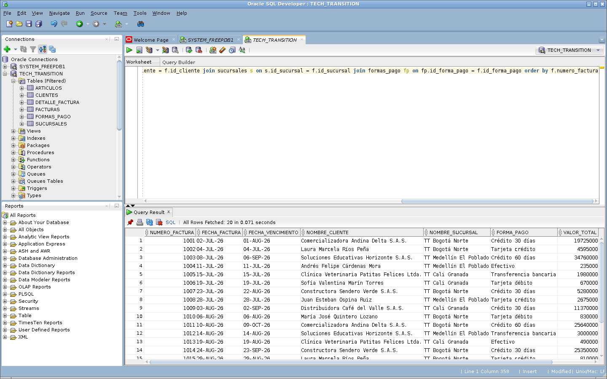

**Figura 20.** Consulta de facturas con cliente, sucursal y forma de pago en SQL Developer

La Figura 20 es una captura real de SQL Developer con la conexión TECH_TRANSITION. En la hoja de trabajo se ejecutó una consulta con tres `JOIN` (FACTURAS con CLIENTES, SUCURSALES y FORMAS_PAGO) ordenada por número de factura. El panel *Query Result* indica "All Rows Fetched: 20 in 0.071 seconds" y muestra, por ejemplo, la factura 1001 del 2 de julio de 2026 de "Comercializadora Andina Delta S.A.S." en "TT Bogotá Norte" con "Crédito 30 días" y vencimiento el 1 de agosto. Se observa que las tildes y la letra ñ se almacenaron correctamente (juego de caracteres AL32UTF8).

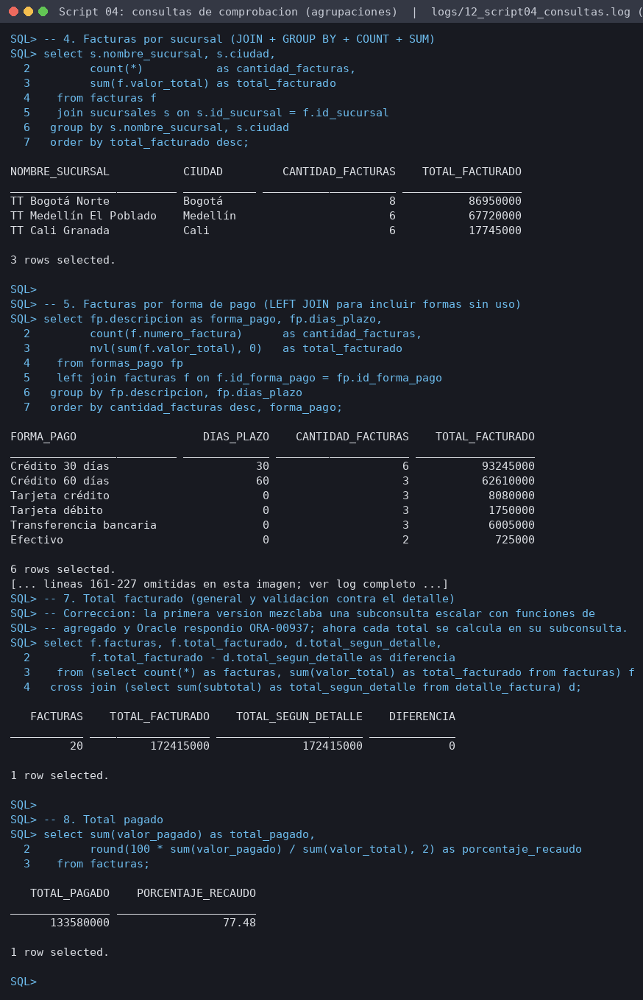

**Figura 21.** Consultas agrupadas: por sucursal, por forma de pago y totales

En la Figura 21 se observan las consultas 4, 5, 7 y 8. Por sucursal, TT Bogotá Norte registra 8 facturas por $86.950.000, TT Medellín El Poblado 6 por $67.720.000 y TT Cali Granada 6 por $17.745.000. Por forma de pago, "Crédito 30 días" es la más usada (6 facturas, $93.245.000). El total facturado es de $172.415.000 y coincide exactamente con la suma del detalle (diferencia 0); el total pagado es de $133.580.000, un recaudo del 77,48 %.

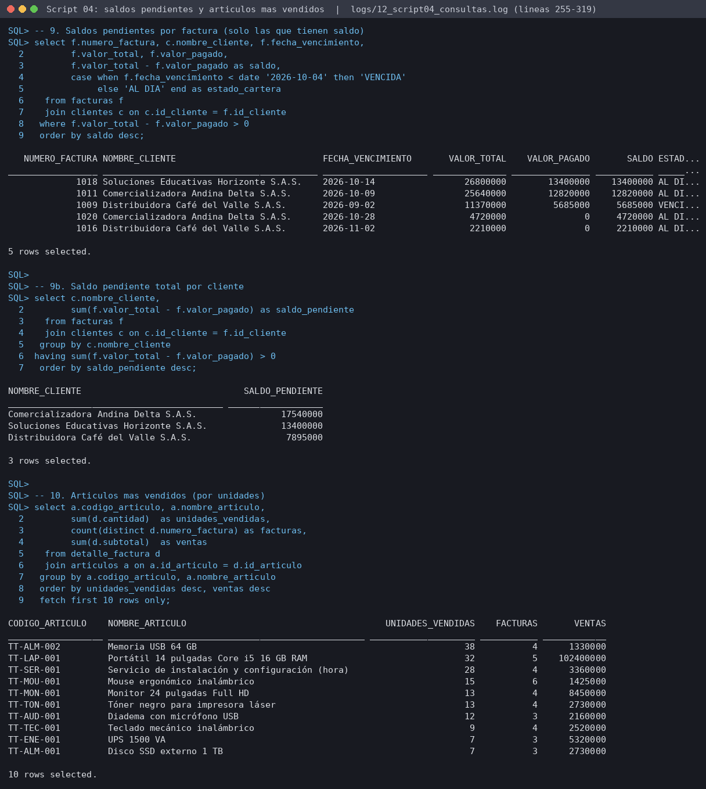

**Figura 22.** Saldos pendientes y artículos más vendidos

La Figura 22 muestra las consultas 9, 9b y 10. Cinco facturas tienen saldo pendiente por un total de $38.835.000; la factura 1009 de "Distribuidora Café del Valle S.A.S." aparece como **VENCIDA** (venció el 2 de septiembre de 2026 con un saldo de $5.685.000), mientras que las demás están al día. Por cliente, "Comercializadora Andina Delta S.A.S." concentra el mayor saldo ($17.540.000). En unidades, el artículo más vendido es la "Memoria USB 64 GB" (38 unidades), seguido del "Portátil 14 pulgadas Core i5" (32 unidades), que es a la vez el de mayor valor vendido ($102.400.000).

Las salidas completas de las once consultas están en `logs/12_script04_consultas.log` (Anexo B) y los datos de cada tabla exportados a CSV en `resultados/consultas_csv/`.

## 18. Resultados obtenidos

### 18.1 Validación de la instalación y del esquema

El script `sql/05_verificacion.sql`, ejecutado como SYSTEM, comprobó de forma integral la instalación y la base de datos.

**Tabla 16.** Resultados de la validación (valores reales del log `13_script05_verificacion.log`)

| Verificación | Resultado |
|---|---|
| Versión de Oracle | Oracle AI Database 26ai Free Release 23.26.3.0.0 |
| Estado de la instancia | FREE: OPEN / ACTIVE, iniciada 2026-10-04 12:31:01 |
| Estado del servicio / PDB | Servicio `freepdb1` activo; PDB FREEPDB1 en READ WRITE |
| Conexiones abiertas | SYSTEM (SQL Developer), SYSTEM (SQLcl) y TECH_TRANSITION (SQL Developer) |
| Cantidad de tablas | 6 |
| Cantidad de registros | 10 + 3 + 6 + 15 + 20 + 52 = 106 |
| Claves primarias | 6 |
| Claves foráneas | 5 |
| Restricciones UNIQUE | 5 |
| Restricciones CHECK de negocio | 10 (todas ENABLED) |
| Restricciones NOT NULL | 32 |
| Total de restricciones | 58 |
| Índices | 16 (11 únicos y 5 no únicos) |
| Facturas con total inconsistente | 0 |

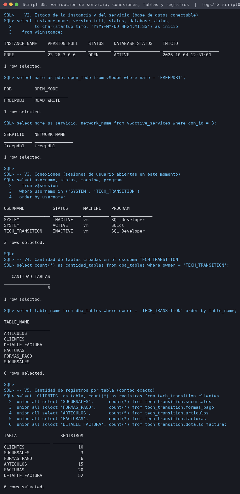

**Figura 23.** Validación del servicio, las conexiones, las tablas y los registros

La Figura 23 muestra las consultas V2 a V5: el estado `OPEN`/`ACTIVE` de la instancia, la PDB `FREEPDB1` en `READ WRITE`, el servicio `freepdb1`, las tres sesiones de usuario conectadas en ese momento (dos desde SQL Developer y una desde SQLcl, lo que prueba conexiones simultáneas), la cantidad de tablas del esquema (6) con sus nombres, y el conteo exacto de registros de cada tabla.

### 18.2 Pruebas de integridad

Para demostrar que la base de datos protege la calidad de la información se intentaron siete operaciones inválidas. **Todas debían fallar** y todas fueron rechazadas por Oracle con el error esperado; al final se ejecutó `ROLLBACK` y se comprobó que los conteos no cambiaron.

**Tabla 17.** Pruebas de integridad

| Prueba | Operación intentada | Error esperado | Error obtenido |
|---|---|---|---|
| a | Insertar un cliente con `id_cliente` repetido | ORA-00001 | ORA-00001 (PK_CLIENTES) |
| b | Factura con un cliente inexistente (999) | ORA-02291 | ORA-02291 (FK_FACTURAS_CLIENTES) |
| c | Borrar un cliente que tiene facturas | ORA-02292 | ORA-02292 (FK_FACTURAS_CLIENTES) |
| d | Detalle con cantidad negativa | ORA-02290 | ORA-02290 (CK_DETALLE_CANTIDAD) |
| e | Vencimiento anterior a la fecha de factura | ORA-02290 | ORA-02290 (CK_FACTURAS_FECHAS) |
| f | Valor pagado mayor que el total | ORA-02290 | ORA-02290 (CK_FACTURAS_PAGADO) |
| g | Artículo sin nombre (NULL) | ORA-01400 | ORA-01400 (NOMBRE_ARTICULO) |

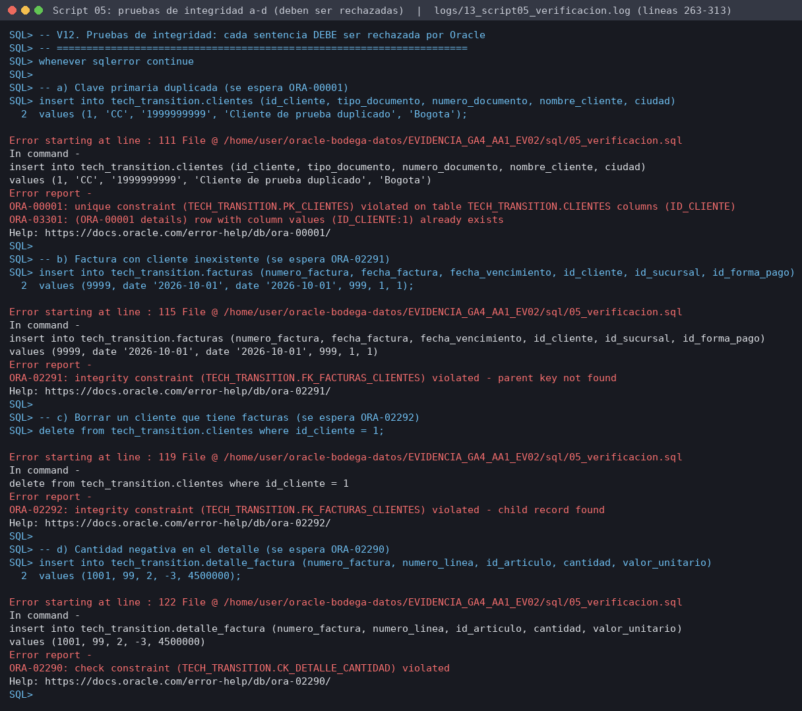

**Figura 24.** Pruebas de integridad a – d

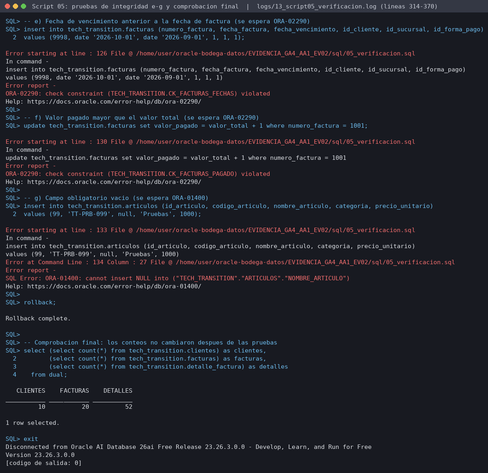

**Figura 25.** Pruebas de integridad e – g y comprobación final

En las Figuras 24 y 25 se observa cada sentencia inválida seguida del reporte de error de Oracle (en rojo): violación de clave primaria, de clave foránea al insertar (*parent key not found*) y al borrar (*child record found*), de las restricciones CHECK de cantidad, fechas y valor pagado, y de la restricción NOT NULL. Al final, después del `ROLLBACK`, la consulta de control devuelve 10 clientes, 20 facturas y 52 detalles: ningún dato inválido ingresó a la base de datos.

### 18.3 Prueba final: reinicio del servicio y persistencia

Como prueba final se detuvo y se volvió a iniciar el servicio de Oracle y se consultaron de nuevo los datos.

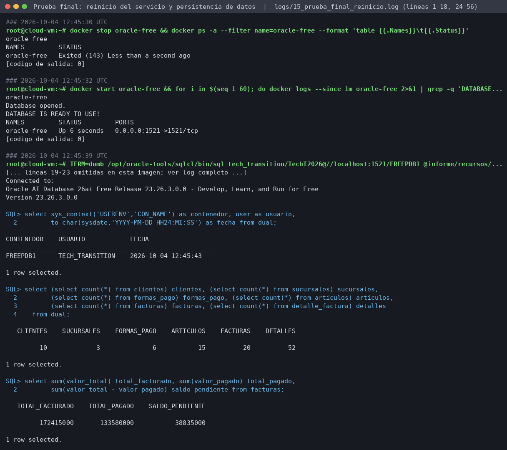

**Figura 26.** Prueba final: reinicio del servicio y persistencia de los datos

En la Figura 26 se ve `docker stop oracle-free` (estado `Exited`), luego `docker start oracle-free` con los mensajes `Database opened` y `DATABASE IS READY TO USE!` (el arranque tomó unos 7 segundos porque los datos ya existían en el volumen) y, por último, una conexión con SQLcl como TECH_TRANSITION que muestra los mismos conteos (10, 3, 6, 15, 20 y 52) y los mismos totales: facturado $172.415.000, pagado $133.580.000 y saldo $38.835.000. Los datos persistieron después del reinicio.

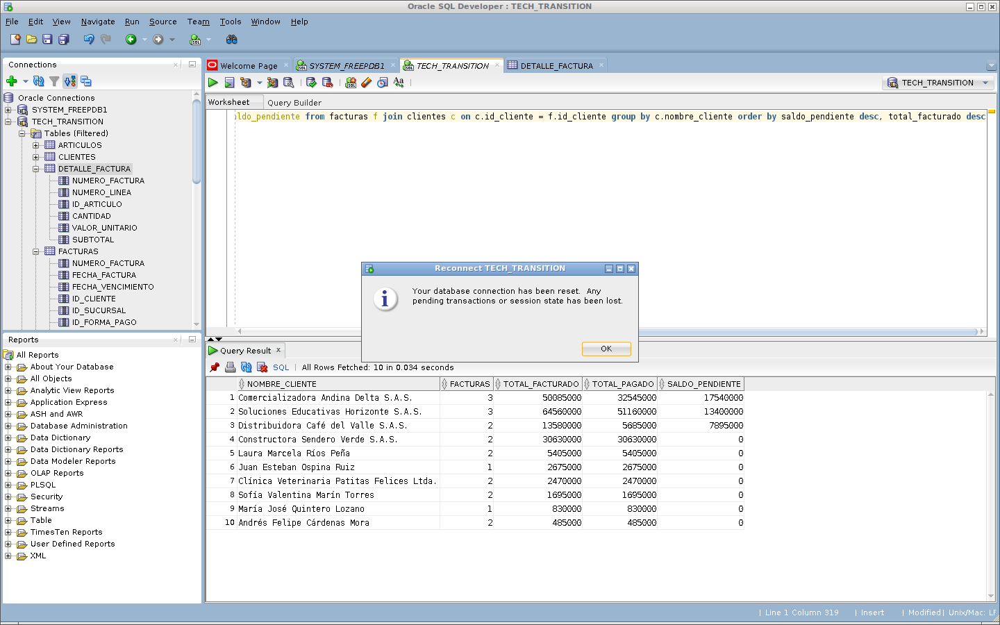

**Figura 27.** Reconexión de SQL Developer después del reinicio

La Figura 27, captura real de SQL Developer, muestra el aviso "Your database connection has been reset", que la herramienta presentó porque la sesión anterior se cerró con el reinicio del servicio; SQL Developer se reconectó automáticamente y ejecutó la consulta de facturación por cliente (10 filas), con los valores facturados, pagados y el saldo pendiente de cada cliente.

### 18.4 Síntesis de resultados

- Oracle Database Free quedó instalado, configurado, iniciado y accesible por el puerto 1521.
- Se instalaron y usaron SQL Developer 24.3.1, SQLcl 26.3 y SQL*Plus 23.26.
- Se creó el esquema TECH_TRANSITION con 6 tablas normalizadas, 58 restricciones y 16 índices.
- Se cargaron 106 registros ficticios coherentes y se verificó la consistencia de los totales.
- Las 11 consultas y las 7 pruebas de integridad dieron los resultados esperados (la consulta 7 requirió una corrección, ver sección 19).
- Los datos persistieron tras reiniciar el servicio.

## 19. Problemas encontrados y soluciones

**Tabla 18.** Problemas encontrados durante la práctica

| N.º | Problema (real) | Causa | Solución aplicada | Evidencia |
|---|---|---|---|---|
| 1 | El equipo personal no tenía recursos para Oracle | Memoria y disco insuficientes | Se usó una máquina virtual en la nube (4 vCPU, 15 GiB RAM) | `logs/01_entorno.log` |
| 2 | La descarga oficial de los RPM de Oracle Free y XE 21c, y del registro de contenedores de Oracle, devolvió HTTP 403 | La política de red del entorno cloud bloquea `edelivery.oracle.com` y `container-registry.oracle.com` | Se usó la imagen `gvenzl/oracle-free:23-slim` de Docker Hub. Limitación: no se ejecutó el instalador oficial nativo | `logs/03_descarga.log` |
| 3 | Ubuntu no está entre los sistemas soportados para la instalación nativa y no hay systemd | Oracle certifica Oracle Linux/RHEL; el entorno es un contenedor sin gestor de servicios | Instalación en contenedor Docker | `logs/01_entorno.log` |
| 4 | Docker instalado pero sin servicio (`docker.sock` inexistente) | Sin systemd el daemon no arranca solo | Se inició `dockerd` manualmente | `logs/02_preparacion.log` |
| 5 | `ps` no existe en la imagen *slim* y `ss` no existía en el host | Imagen mínima / paquete `iproute2` no instalado | Se listaron los procesos desde el host y se instaló `iproute2` | `logs/06_…log` |
| 6 | ORA-00911 en la primera consulta de versión | Error del aprendiz al escapar el símbolo `$` de `v$version` dentro de un *heredoc* de Bash | Se escribieron las consultas en archivos `.sql` | `logs/07_version_intento_fallido_escapado.log` |
| 7 | SQLcl en modo `-S` no mostraba el eco de los comandos y agregaba códigos de color ANSI | Comportamiento del modo silencioso y del formato *ansiconsole* de SQLcl | Se ejecutó sin `-S` y se eliminaron los códigos ANSI de los logs con `sed` (el texto no cambia) | `logs/09_script01_primer_intento_formato_ansi.log` |
| 8 | ORA-00937 en la consulta 7 (total facturado) | Mezcla de una subconsulta escalar con funciones de agregado sin GROUP BY | Cada total se calculó en una subconsulta del FROM unida con CROSS JOIN | `logs/12_script04_consultas_intento1_error_ORA-00937.log` |
| 9 | Mensaje "Unable to obtain current patch information due to error: 20013" en el *alert log* | Mensaje informativo del arranque del contenedor | No afectó el funcionamiento: la base de datos y la PDB abrieron normalmente | `logs/05_configuracion.log` |
| 10 | No hay pantalla para la interfaz gráfica de SQL Developer | Servidor sin entorno de escritorio | Se usó Xvfb + openbox y se tomaron capturas con `import` (ImageMagick) | Figuras 6, 9, 10, 14, 16, 18, 20 y 27 |
| 11 | La vista *Model* de DETALLE_FACTURA no dibujó la línea hacia ARTICULOS | Limitación de la vista de SQL Developer | La relación se verificó en el diccionario (consulta V7) | Figura 19 |
| 12 | Cada programa Java imprime la línea `Picked up JAVA_TOOL_OPTIONS` | Configuración del proxy del entorno cloud | Se filtró esa línea con `grep -v` (visible en el comando registrado) | Logs 09 a 15 |

## 20. Conclusiones

1. Fue posible instalar y poner en funcionamiento un motor Oracle real (Oracle AI Database 26ai Free, versión 23.26.3.0.0) en un entorno cloud, lo que demuestra que no disponer de un computador potente no impide realizar la práctica, siempre que se documenten con claridad las condiciones del entorno.
2. Las restricciones de red del entorno impidieron usar el instalador oficial nativo. La instalación en contenedor resultó una alternativa válida y rápida: en menos de dos minutos la base de datos estuvo lista, con su servicio, *listener* y procesos verificados, y el volumen persistente garantizó que los datos sobrevivieran al reinicio.
3. La verificación posterior a la instalación (procesos, puertos, versión y conexión) es indispensable: confirma que el servicio no solo está "instalado" sino disponible para los clientes, como se comprobó desde SQL Developer, SQLcl, SQL*Plus y un cliente de red.
4. Para el caso TECH TRANSITION, normalizar la información en seis tablas eliminó la redundancia de una tabla plana y permitió que cada dato exigido por la guía (número y fechas de factura, cliente, sucursal, forma de pago, valores, artículo, cantidad y valor unitario) tenga un único lugar y una relación clara con los demás.
5. Las restricciones de integridad son la principal defensa de la calidad de los datos: las siete operaciones inválidas fueron rechazadas por el propio motor, algo que una hoja de cálculo no puede garantizar.
6. Las consultas con JOIN, GROUP BY, SUM, COUNT y ORDER BY transformaron los registros en información útil para la toma de decisiones: se identificó que el 77,48 % de lo facturado está recaudado, que existe una factura vencida y que la sucursal de Bogotá concentra la mayor facturación. Este modelo constituye la base para la futura bodega de datos del área de facturación.
7. Los errores cometidos durante la práctica (ORA-00911 y ORA-00937) se conservaron y corrigieron; documentarlos fortalece el aprendizaje y la transparencia de la evidencia.

## 21. Referencias

- Docker Inc. (s. f.). *Docker documentation*. https://docs.docker.com/
- Oracle. (s. f.). *Oracle Database Free*. https://www.oracle.com/database/free/
- Oracle. (s. f.). *Oracle Database Express Edition (XE) downloads*. https://www.oracle.com/database/technologies/xe-downloads.html
- Oracle. (s. f.). *Oracle SQL Developer*. https://www.oracle.com/database/sqldeveloper/
- Oracle. (s. f.). *Oracle SQLcl*. https://www.oracle.com/database/sqldeveloper/technologies/sqlcl/
- Oracle. (s. f.). *Oracle Database SQL Language Reference*. https://docs.oracle.com/en/database/oracle/oracle-database/23/sqlrf/
- Oracle. (s. f.). *python-oracledb documentation*. https://python-oracledb.readthedocs.io/
- SENA. (s. f.). *Guía de aprendizaje GA4 – Implementación y gestión de bases de datos (228130), formato GFPI-F-135 V01*. Servicio Nacional de Aprendizaje.
- Venzl, G. (s. f.). *oci-oracle-free: Oracle Database Free container images* [Repositorio]. GitHub. https://github.com/gvenzl/oci-oracle-free

## 22. Anexos

### Anexo A. Scripts SQL completos

Todos los scripts están en la carpeta `sql/` del repositorio de la evidencia y se ejecutaron en este orden.

#### A.1 `sql/01_creacion_usuario.sql`

```sql
-- =====================================================================
-- Evidencia GA4-210602033-AA1-EV02 - Caso de estudio TECH TRANSITION
-- Script 01: creacion del usuario/esquema TECH_TRANSITION
-- Ejecutar conectado como SYSTEM a la base de datos conectable FREEPDB1
--   sql system/<clave>@//localhost:1521/FREEPDB1 @01_creacion_usuario.sql
-- =====================================================================
set echo on
set feedback on
set linesize 150
set pagesize 50

show user
show con_name

-- Se elimina el esquema si ya existia (permite re-ejecutar la practica)
drop user if exists tech_transition cascade;

-- Creacion del usuario propietario del esquema de facturacion
create user tech_transition identified by "TechT2026"
  default tablespace users
  temporary tablespace temp
  quota 200m on users;

-- Privilegios minimos necesarios para el desarrollo del caso
grant create session  to tech_transition;
grant create table    to tech_transition;
grant create view     to tech_transition;
grant create sequence to tech_transition;
grant create trigger  to tech_transition;

-- Verificacion del usuario creado
column username format a16
column account_status format a14
column default_tablespace format a12
select username, account_status, default_tablespace, created
  from dba_users
 where username = 'TECH_TRANSITION';

column privilege format a20
select grantee, privilege
  from dba_sys_privs
 where grantee = 'TECH_TRANSITION'
 order by privilege;

column tablespace_name format a12
select tablespace_name, max_bytes/1024/1024 as cuota_mb
  from dba_ts_quotas
 where username = 'TECH_TRANSITION';
exit
```

#### A.2 `sql/02_creacion_tablas.sql`

```sql
-- =====================================================================
-- Evidencia GA4-210602033-AA1-EV02 - Caso de estudio TECH TRANSITION
-- Script 02: creacion de tablas, restricciones, indices y comentarios
-- Ejecutar conectado como TECH_TRANSITION a FREEPDB1
--   sql tech_transition/<clave>@//localhost:1521/FREEPDB1 @02_creacion_tablas.sql
-- Modelo normalizado (3FN):
--   CLIENTES, SUCURSALES, FORMAS_PAGO, ARTICULOS  (tablas maestras)
--   FACTURAS                                       (encabezado)
--   DETALLE_FACTURA                                (lineas de la factura)
-- =====================================================================
set echo on
set feedback on
set linesize 150
set pagesize 50

show user

-- ---------------------------------------------------------------------
-- 1. CLIENTES
-- ---------------------------------------------------------------------
create table clientes (
  id_cliente        number(6)      not null,
  tipo_documento    varchar2(3)    not null,
  numero_documento  varchar2(15)   not null,
  nombre_cliente    varchar2(100)  not null,
  telefono          varchar2(15),
  correo            varchar2(100),
  direccion         varchar2(120),
  ciudad            varchar2(50)   not null,
  fecha_registro    date           default sysdate not null,
  constraint pk_clientes primary key (id_cliente),
  constraint uq_clientes_documento unique (tipo_documento, numero_documento),
  constraint ck_clientes_tipo_doc check (tipo_documento in ('CC', 'CE', 'NIT')),
  constraint ck_clientes_correo check (correo is null or correo like '%_@_%._%')
);

-- ---------------------------------------------------------------------
-- 2. SUCURSALES
-- ---------------------------------------------------------------------
create table sucursales (
  id_sucursal      number(4)      not null,
  nombre_sucursal  varchar2(60)   not null,
  ciudad           varchar2(50)   not null,
  direccion        varchar2(120)  not null,
  telefono         varchar2(15),
  constraint pk_sucursales primary key (id_sucursal),
  constraint uq_sucursales_nombre unique (nombre_sucursal)
);

-- ---------------------------------------------------------------------
-- 3. FORMAS_PAGO
-- ---------------------------------------------------------------------
create table formas_pago (
  id_forma_pago  number(2)     not null,
  descripcion    varchar2(40)  not null,
  dias_plazo     number(3)     default 0 not null,
  constraint pk_formas_pago primary key (id_forma_pago),
  constraint uq_formas_pago_desc unique (descripcion),
  constraint ck_formas_pago_dias check (dias_plazo between 0 and 180)
);

-- ---------------------------------------------------------------------
-- 4. ARTICULOS
-- ---------------------------------------------------------------------
create table articulos (
  id_articulo      number(6)      not null,
  codigo_articulo  varchar2(20)   not null,
  nombre_articulo  varchar2(100)  not null,
  categoria        varchar2(40)   not null,
  precio_unitario  number(12,2)   not null,
  estado           char(1)        default 'A' not null,
  constraint pk_articulos primary key (id_articulo),
  constraint uq_articulos_codigo unique (codigo_articulo),
  constraint ck_articulos_precio check (precio_unitario > 0),
  constraint ck_articulos_estado check (estado in ('A', 'I'))
);

-- ---------------------------------------------------------------------
-- 5. FACTURAS (encabezado)
-- ---------------------------------------------------------------------
create table facturas (
  numero_factura     number(10)     not null,
  fecha_factura      date           not null,
  fecha_vencimiento  date           not null,
  id_cliente         number(6)      not null,
  id_sucursal        number(4)      not null,
  id_forma_pago      number(2)      not null,
  valor_total        number(14,2)   default 0 not null,
  valor_pagado       number(14,2)   default 0 not null,
  constraint pk_facturas primary key (numero_factura),
  constraint fk_facturas_clientes foreign key (id_cliente)
    references clientes (id_cliente),
  constraint fk_facturas_sucursales foreign key (id_sucursal)
    references sucursales (id_sucursal),
  constraint fk_facturas_formas_pago foreign key (id_forma_pago)
    references formas_pago (id_forma_pago),
  constraint ck_facturas_fechas check (fecha_vencimiento >= fecha_factura),
  constraint ck_facturas_total check (valor_total >= 0),
  constraint ck_facturas_pagado check (valor_pagado >= 0 and valor_pagado <= valor_total)
);

-- ---------------------------------------------------------------------
-- 6. DETALLE_FACTURA (lineas de cada factura)
-- ---------------------------------------------------------------------
create table detalle_factura (
  numero_factura  number(10)    not null,
  numero_linea    number(3)     not null,
  id_articulo     number(6)     not null,
  cantidad        number(6)     not null,
  valor_unitario  number(12,2)  not null,
  subtotal        number(14,2)  generated always as (cantidad * valor_unitario) virtual,
  constraint pk_detalle_factura primary key (numero_factura, numero_linea),
  constraint fk_detalle_facturas foreign key (numero_factura)
    references facturas (numero_factura) on delete cascade,
  constraint fk_detalle_articulos foreign key (id_articulo)
    references articulos (id_articulo),
  constraint uq_detalle_articulo unique (numero_factura, id_articulo),
  constraint ck_detalle_cantidad check (cantidad > 0),
  constraint ck_detalle_valor check (valor_unitario >= 0)
);

-- ---------------------------------------------------------------------
-- Indices sobre las claves foraneas (mejoran los JOIN y evitan bloqueos)
-- ---------------------------------------------------------------------
create index ix_facturas_cliente   on facturas (id_cliente);
create index ix_facturas_sucursal  on facturas (id_sucursal);
create index ix_facturas_forma     on facturas (id_forma_pago);
create index ix_facturas_fecha     on facturas (fecha_factura);
create index ix_detalle_articulo   on detalle_factura (id_articulo);

-- ---------------------------------------------------------------------
-- Comentarios (documentan el diccionario de datos dentro de Oracle)
-- ---------------------------------------------------------------------
comment on table clientes is 'Clientes a quienes TECH TRANSITION emite facturas';
comment on column clientes.id_cliente is 'Identificador interno del cliente';
comment on column clientes.tipo_documento is 'Tipo de documento: CC, CE o NIT';
comment on column clientes.numero_documento is 'Numero del documento de identificacion';
comment on column clientes.nombre_cliente is 'Nombre o razon social del cliente';
comment on column clientes.telefono is 'Telefono de contacto';
comment on column clientes.correo is 'Correo electronico para envio de facturas';
comment on column clientes.direccion is 'Direccion del cliente';
comment on column clientes.ciudad is 'Ciudad del cliente';
comment on column clientes.fecha_registro is 'Fecha de registro del cliente';

comment on table sucursales is 'Sucursales de TECH TRANSITION que emiten facturas';
comment on column sucursales.id_sucursal is 'Identificador de la sucursal';
comment on column sucursales.nombre_sucursal is 'Nombre de la sucursal';
comment on column sucursales.ciudad is 'Ciudad donde opera la sucursal';
comment on column sucursales.direccion is 'Direccion de la sucursal';
comment on column sucursales.telefono is 'Telefono de la sucursal';

comment on table formas_pago is 'Catalogo de formas de pago aceptadas';
comment on column formas_pago.id_forma_pago is 'Identificador de la forma de pago';
comment on column formas_pago.descripcion is 'Nombre de la forma de pago';
comment on column formas_pago.dias_plazo is 'Dias de plazo para el pago (0 = contado)';

comment on table articulos is 'Catalogo de articulos que se facturan';
comment on column articulos.id_articulo is 'Identificador interno del articulo';
comment on column articulos.codigo_articulo is 'Codigo comercial (SKU) del articulo';
comment on column articulos.nombre_articulo is 'Descripcion del articulo';
comment on column articulos.categoria is 'Categoria del articulo';
comment on column articulos.precio_unitario is 'Precio de lista vigente en pesos colombianos';
comment on column articulos.estado is 'A = activo, I = inactivo';

comment on table facturas is 'Encabezado de las facturas de venta';
comment on column facturas.numero_factura is 'Numero consecutivo de la factura';
comment on column facturas.fecha_factura is 'Fecha de expedicion de la factura';
comment on column facturas.fecha_vencimiento is 'Fecha limite de pago';
comment on column facturas.id_cliente is 'Cliente facturado (FK a CLIENTES)';
comment on column facturas.id_sucursal is 'Sucursal que factura (FK a SUCURSALES)';
comment on column facturas.id_forma_pago is 'Forma de pago (FK a FORMAS_PAGO)';
comment on column facturas.valor_total is 'Valor total de la factura (suma de subtotales)';
comment on column facturas.valor_pagado is 'Valor abonado por el cliente';

comment on table detalle_factura is 'Lineas de articulos de cada factura';
comment on column detalle_factura.numero_factura is 'Factura a la que pertenece la linea (FK a FACTURAS)';
comment on column detalle_factura.numero_linea is 'Numero de linea dentro de la factura';
comment on column detalle_factura.id_articulo is 'Articulo vendido (FK a ARTICULOS)';
comment on column detalle_factura.cantidad is 'Cantidad de unidades vendidas';
comment on column detalle_factura.valor_unitario is 'Valor unitario aplicado en la venta';
comment on column detalle_factura.subtotal is 'Columna virtual: cantidad * valor_unitario';

-- Comprobacion rapida de las tablas creadas
column table_name format a20
select table_name, num_rows from user_tables order by table_name;
exit
```

#### A.3 `sql/03_insercion_datos.sql`

```sql
-- =====================================================================
-- Evidencia GA4-210602033-AA1-EV02 - Caso de estudio TECH TRANSITION
-- Script 03: insercion de datos de prueba (informacion FICTICIA)
-- Ejecutar conectado como TECH_TRANSITION a FREEPDB1
-- Nota: todos los nombres, documentos, telefonos y correos son inventados
--       (dominio reservado example.com); no corresponden a personas reales.
-- =====================================================================
set echo on
set feedback on
set linesize 150
set pagesize 60
alter session set nls_date_format = 'YYYY-MM-DD';

show user

-- ---------------- CLIENTES (10) ----------------
insert into clientes (id_cliente, tipo_documento, numero_documento, nombre_cliente, telefono, correo, direccion, ciudad, fecha_registro)
  values (1, 'NIT', '900000001', 'Comercializadora Andina Delta S.A.S.', '3000000001', 'compras@andinadelta.example.com', 'Calle 100 # 10-20', 'Bogotá', date '2026-01-15');
insert into clientes (id_cliente, tipo_documento, numero_documento, nombre_cliente, telefono, correo, direccion, ciudad, fecha_registro)
  values (2, 'CC', '1000000002', 'Laura Marcela Ríos Peña', '3000000002', 'laura.rios@correo.example.com', 'Carrera 15 # 85-30', 'Bogotá', date '2026-02-03');
insert into clientes (id_cliente, tipo_documento, numero_documento, nombre_cliente, telefono, correo, direccion, ciudad, fecha_registro)
  values (3, 'NIT', '900000003', 'Soluciones Educativas Horizonte S.A.S.', '3000000003', 'facturacion@horizonte.example.com', 'Calle 50 # 45-12', 'Medellín', date '2026-02-20');
insert into clientes (id_cliente, tipo_documento, numero_documento, nombre_cliente, telefono, correo, direccion, ciudad, fecha_registro)
  values (4, 'CC', '1000000004', 'Andrés Felipe Cárdenas Mora', '3000000004', 'andres.cardenas@correo.example.com', 'Carrera 70 # 30-15', 'Medellín', date '2026-03-11');
insert into clientes (id_cliente, tipo_documento, numero_documento, nombre_cliente, telefono, correo, direccion, ciudad, fecha_registro)
  values (5, 'NIT', '900000005', 'Clínica Veterinaria Patitas Felices Ltda.', '3000000005', 'admin@patitasfelices.example.com', 'Avenida 6N # 20-40', 'Cali', date '2026-03-25');
insert into clientes (id_cliente, tipo_documento, numero_documento, nombre_cliente, telefono, correo, direccion, ciudad, fecha_registro)
  values (6, 'CE', '500000006', 'Sofía Valentina Marín Torres', '3000000006', 'sofia.marin@correo.example.com', 'Calle 5 # 38-22', 'Cali', date '2026-04-08');
insert into clientes (id_cliente, tipo_documento, numero_documento, nombre_cliente, telefono, correo, direccion, ciudad, fecha_registro)
  values (7, 'NIT', '900000007', 'Constructora Sendero Verde S.A.S.', '3000000007', 'tesoreria@senderoverde.example.com', 'Avenida 68 # 24-10', 'Bogotá', date '2026-04-30');
insert into clientes (id_cliente, tipo_documento, numero_documento, nombre_cliente, telefono, correo, direccion, ciudad, fecha_registro)
  values (8, 'CC', '1000000008', 'Juan Esteban Ospina Ruiz', '3000000008', 'juan.ospina@correo.example.com', 'Calle 10 # 43-60', 'Medellín', date '2026-05-14');
insert into clientes (id_cliente, tipo_documento, numero_documento, nombre_cliente, telefono, correo, direccion, ciudad, fecha_registro)
  values (9, 'NIT', '900000009', 'Distribuidora Café del Valle S.A.S.', '3000000009', 'pagos@cafedelvalle.example.com', 'Carrera 1 # 70-15', 'Cali', date '2026-06-02');
insert into clientes (id_cliente, tipo_documento, numero_documento, nombre_cliente, telefono, correo, direccion, ciudad, fecha_registro)
  values (10, 'CC', '1000000010', 'María José Quintero Lozano', '3000000010', 'mariajose.quintero@correo.example.com', 'Calle 140 # 19-05', 'Bogotá', date '2026-06-19');

-- ---------------- SUCURSALES (3) ----------------
insert into sucursales (id_sucursal, nombre_sucursal, ciudad, direccion, telefono)
  values (1, 'TT Bogotá Norte', 'Bogotá', 'Autopista Norte # 120-45 Local 3', '6010000001');
insert into sucursales (id_sucursal, nombre_sucursal, ciudad, direccion, telefono)
  values (2, 'TT Medellín El Poblado', 'Medellín', 'Carrera 43A # 10-25 Local 8', '6040000002');
insert into sucursales (id_sucursal, nombre_sucursal, ciudad, direccion, telefono)
  values (3, 'TT Cali Granada', 'Cali', 'Avenida 9N # 15-30 Local 2', '6020000003');

-- ---------------- FORMAS_PAGO (6) ----------------
insert into formas_pago (id_forma_pago, descripcion, dias_plazo) values (1, 'Efectivo', 0);
insert into formas_pago (id_forma_pago, descripcion, dias_plazo) values (2, 'Tarjeta débito', 0);
insert into formas_pago (id_forma_pago, descripcion, dias_plazo) values (3, 'Tarjeta crédito', 0);
insert into formas_pago (id_forma_pago, descripcion, dias_plazo) values (4, 'Transferencia bancaria', 0);
insert into formas_pago (id_forma_pago, descripcion, dias_plazo) values (5, 'Crédito 30 días', 30);
insert into formas_pago (id_forma_pago, descripcion, dias_plazo) values (6, 'Crédito 60 días', 60);

-- ---------------- ARTICULOS (15) ----------------
insert into articulos (id_articulo, codigo_articulo, nombre_articulo, categoria, precio_unitario, estado)
  values (1, 'TT-LAP-001', 'Portátil 14 pulgadas Core i5 16 GB RAM', 'Computadores', 3200000, 'A');
insert into articulos (id_articulo, codigo_articulo, nombre_articulo, categoria, precio_unitario, estado)
  values (2, 'TT-LAP-002', 'Portátil 15.6 pulgadas Ryzen 7 32 GB RAM', 'Computadores', 4500000, 'A');
insert into articulos (id_articulo, codigo_articulo, nombre_articulo, categoria, precio_unitario, estado)
  values (3, 'TT-MON-001', 'Monitor 24 pulgadas Full HD', 'Monitores', 650000, 'A');
insert into articulos (id_articulo, codigo_articulo, nombre_articulo, categoria, precio_unitario, estado)
  values (4, 'TT-MON-002', 'Monitor 27 pulgadas 2K', 'Monitores', 1150000, 'A');
insert into articulos (id_articulo, codigo_articulo, nombre_articulo, categoria, precio_unitario, estado)
  values (5, 'TT-TEC-001', 'Teclado mecánico inalámbrico', 'Periféricos', 280000, 'A');
insert into articulos (id_articulo, codigo_articulo, nombre_articulo, categoria, precio_unitario, estado)
  values (6, 'TT-MOU-001', 'Mouse ergonómico inalámbrico', 'Periféricos', 95000, 'A');
insert into articulos (id_articulo, codigo_articulo, nombre_articulo, categoria, precio_unitario, estado)
  values (7, 'TT-AUD-001', 'Diadema con micrófono USB', 'Periféricos', 180000, 'A');
insert into articulos (id_articulo, codigo_articulo, nombre_articulo, categoria, precio_unitario, estado)
  values (8, 'TT-IMP-001', 'Impresora multifuncional láser', 'Impresión', 1350000, 'A');
insert into articulos (id_articulo, codigo_articulo, nombre_articulo, categoria, precio_unitario, estado)
  values (9, 'TT-TON-001', 'Tóner negro para impresora láser', 'Consumibles', 210000, 'A');
insert into articulos (id_articulo, codigo_articulo, nombre_articulo, categoria, precio_unitario, estado)
  values (10, 'TT-RED-001', 'Router Wi-Fi 6 doble banda', 'Redes', 420000, 'A');
insert into articulos (id_articulo, codigo_articulo, nombre_articulo, categoria, precio_unitario, estado)
  values (11, 'TT-RED-002', 'Switch 24 puertos gigabit', 'Redes', 890000, 'A');
insert into articulos (id_articulo, codigo_articulo, nombre_articulo, categoria, precio_unitario, estado)
  values (12, 'TT-ALM-001', 'Disco SSD externo 1 TB', 'Almacenamiento', 390000, 'A');
insert into articulos (id_articulo, codigo_articulo, nombre_articulo, categoria, precio_unitario, estado)
  values (13, 'TT-ALM-002', 'Memoria USB 64 GB', 'Almacenamiento', 35000, 'A');
insert into articulos (id_articulo, codigo_articulo, nombre_articulo, categoria, precio_unitario, estado)
  values (14, 'TT-ENE-001', 'UPS 1500 VA', 'Energía', 760000, 'A');
insert into articulos (id_articulo, codigo_articulo, nombre_articulo, categoria, precio_unitario, estado)
  values (15, 'TT-SER-001', 'Servicio de instalación y configuración (hora)', 'Servicios', 120000, 'A');

commit;

-- ---------------- FACTURAS (20) ----------------
-- Se registran con valor_total y valor_pagado en 0; luego se calculan a partir del detalle.
-- La fecha de vencimiento corresponde a la fecha de la factura mas los dias de plazo de la forma de pago.
insert into facturas (numero_factura, fecha_factura, fecha_vencimiento, id_cliente, id_sucursal, id_forma_pago)
  values (1001, date '2026-07-02', date '2026-08-01', 1, 1, 5);
insert into facturas (numero_factura, fecha_factura, fecha_vencimiento, id_cliente, id_sucursal, id_forma_pago)
  values (1002, date '2026-07-04', date '2026-07-04', 2, 1, 3);
insert into facturas (numero_factura, fecha_factura, fecha_vencimiento, id_cliente, id_sucursal, id_forma_pago)
  values (1003, date '2026-07-08', date '2026-09-06', 3, 2, 6);
insert into facturas (numero_factura, fecha_factura, fecha_vencimiento, id_cliente, id_sucursal, id_forma_pago)
  values (1004, date '2026-07-11', date '2026-07-11', 4, 2, 1);
insert into facturas (numero_factura, fecha_factura, fecha_vencimiento, id_cliente, id_sucursal, id_forma_pago)
  values (1005, date '2026-07-15', date '2026-07-15', 5, 3, 4);
insert into facturas (numero_factura, fecha_factura, fecha_vencimiento, id_cliente, id_sucursal, id_forma_pago)
  values (1006, date '2026-07-19', date '2026-07-19', 6, 3, 2);
insert into facturas (numero_factura, fecha_factura, fecha_vencimiento, id_cliente, id_sucursal, id_forma_pago)
  values (1007, date '2026-07-23', date '2026-08-22', 7, 1, 5);
insert into facturas (numero_factura, fecha_factura, fecha_vencimiento, id_cliente, id_sucursal, id_forma_pago)
  values (1008, date '2026-07-28', date '2026-07-28', 8, 2, 3);
insert into facturas (numero_factura, fecha_factura, fecha_vencimiento, id_cliente, id_sucursal, id_forma_pago)
  values (1009, date '2026-08-03', date '2026-09-02', 9, 3, 5);
insert into facturas (numero_factura, fecha_factura, fecha_vencimiento, id_cliente, id_sucursal, id_forma_pago)
  values (1010, date '2026-08-06', date '2026-08-06', 10, 1, 2);
insert into facturas (numero_factura, fecha_factura, fecha_vencimiento, id_cliente, id_sucursal, id_forma_pago)
  values (1011, date '2026-08-10', date '2026-10-09', 1, 1, 6);
insert into facturas (numero_factura, fecha_factura, fecha_vencimiento, id_cliente, id_sucursal, id_forma_pago)
  values (1012, date '2026-08-14', date '2026-08-14', 3, 2, 4);
insert into facturas (numero_factura, fecha_factura, fecha_vencimiento, id_cliente, id_sucursal, id_forma_pago)
  values (1013, date '2026-08-19', date '2026-08-19', 5, 3, 1);
insert into facturas (numero_factura, fecha_factura, fecha_vencimiento, id_cliente, id_sucursal, id_forma_pago)
  values (1014, date '2026-08-24', date '2026-09-23', 7, 1, 5);
insert into facturas (numero_factura, fecha_factura, fecha_vencimiento, id_cliente, id_sucursal, id_forma_pago)
  values (1015, date '2026-08-29', date '2026-08-29', 2, 1, 3);
insert into facturas (numero_factura, fecha_factura, fecha_vencimiento, id_cliente, id_sucursal, id_forma_pago)
  values (1016, date '2026-09-03', date '2026-11-02', 9, 3, 6);
insert into facturas (numero_factura, fecha_factura, fecha_vencimiento, id_cliente, id_sucursal, id_forma_pago)
  values (1017, date '2026-09-08', date '2026-09-08', 4, 2, 2);
insert into facturas (numero_factura, fecha_factura, fecha_vencimiento, id_cliente, id_sucursal, id_forma_pago)
  values (1018, date '2026-09-14', date '2026-10-14', 3, 2, 5);
insert into facturas (numero_factura, fecha_factura, fecha_vencimiento, id_cliente, id_sucursal, id_forma_pago)
  values (1019, date '2026-09-21', date '2026-09-21', 6, 3, 4);
insert into facturas (numero_factura, fecha_factura, fecha_vencimiento, id_cliente, id_sucursal, id_forma_pago)
  values (1020, date '2026-09-28', date '2026-10-28', 1, 1, 5);

-- ---------------- DETALLE_FACTURA ----------------
insert into detalle_factura (numero_factura, numero_linea, id_articulo, cantidad, valor_unitario) values (1001, 1, 1, 5, 3200000);
insert into detalle_factura (numero_factura, numero_linea, id_articulo, cantidad, valor_unitario) values (1001, 2, 3, 5, 650000);
insert into detalle_factura (numero_factura, numero_linea, id_articulo, cantidad, valor_unitario) values (1001, 3, 6, 5, 95000);
insert into detalle_factura (numero_factura, numero_linea, id_articulo, cantidad, valor_unitario) values (1002, 1, 2, 1, 4500000);
insert into detalle_factura (numero_factura, numero_linea, id_articulo, cantidad, valor_unitario) values (1002, 2, 6, 1, 95000);
insert into detalle_factura (numero_factura, numero_linea, id_articulo, cantidad, valor_unitario) values (1003, 1, 1, 10, 3200000);
insert into detalle_factura (numero_factura, numero_linea, id_articulo, cantidad, valor_unitario) values (1003, 2, 7, 10, 180000);
insert into detalle_factura (numero_factura, numero_linea, id_articulo, cantidad, valor_unitario) values (1003, 3, 15, 8, 120000);
insert into detalle_factura (numero_factura, numero_linea, id_articulo, cantidad, valor_unitario) values (1004, 1, 13, 4, 35000);
insert into detalle_factura (numero_factura, numero_linea, id_articulo, cantidad, valor_unitario) values (1004, 2, 6, 1, 95000);
insert into detalle_factura (numero_factura, numero_linea, id_articulo, cantidad, valor_unitario) values (1005, 1, 8, 1, 1350000);
insert into detalle_factura (numero_factura, numero_linea, id_articulo, cantidad, valor_unitario) values (1005, 2, 9, 3, 210000);
insert into detalle_factura (numero_factura, numero_linea, id_articulo, cantidad, valor_unitario) values (1006, 1, 12, 1, 390000);
insert into detalle_factura (numero_factura, numero_linea, id_articulo, cantidad, valor_unitario) values (1006, 2, 5, 1, 280000);
insert into detalle_factura (numero_factura, numero_linea, id_articulo, cantidad, valor_unitario) values (1007, 1, 11, 2, 890000);
insert into detalle_factura (numero_factura, numero_linea, id_articulo, cantidad, valor_unitario) values (1007, 2, 10, 3, 420000);
insert into detalle_factura (numero_factura, numero_linea, id_articulo, cantidad, valor_unitario) values (1007, 3, 14, 2, 760000);
insert into detalle_factura (numero_factura, numero_linea, id_articulo, cantidad, valor_unitario) values (1007, 4, 15, 6, 120000);
insert into detalle_factura (numero_factura, numero_linea, id_articulo, cantidad, valor_unitario) values (1008, 1, 4, 2, 1150000);
insert into detalle_factura (numero_factura, numero_linea, id_articulo, cantidad, valor_unitario) values (1008, 2, 5, 1, 280000);
insert into detalle_factura (numero_factura, numero_linea, id_articulo, cantidad, valor_unitario) values (1008, 3, 6, 1, 95000);
insert into detalle_factura (numero_factura, numero_linea, id_articulo, cantidad, valor_unitario) values (1009, 1, 1, 3, 3200000);
insert into detalle_factura (numero_factura, numero_linea, id_articulo, cantidad, valor_unitario) values (1009, 2, 8, 1, 1350000);
insert into detalle_factura (numero_factura, numero_linea, id_articulo, cantidad, valor_unitario) values (1009, 3, 9, 2, 210000);
insert into detalle_factura (numero_factura, numero_linea, id_articulo, cantidad, valor_unitario) values (1010, 1, 3, 1, 650000);
insert into detalle_factura (numero_factura, numero_linea, id_articulo, cantidad, valor_unitario) values (1010, 2, 7, 1, 180000);
insert into detalle_factura (numero_factura, numero_linea, id_articulo, cantidad, valor_unitario) values (1011, 1, 2, 4, 4500000);
insert into detalle_factura (numero_factura, numero_linea, id_articulo, cantidad, valor_unitario) values (1011, 2, 4, 4, 1150000);
insert into detalle_factura (numero_factura, numero_linea, id_articulo, cantidad, valor_unitario) values (1011, 3, 14, 4, 760000);
insert into detalle_factura (numero_factura, numero_linea, id_articulo, cantidad, valor_unitario) values (1012, 1, 13, 30, 35000);
insert into detalle_factura (numero_factura, numero_linea, id_articulo, cantidad, valor_unitario) values (1012, 2, 12, 5, 390000);
insert into detalle_factura (numero_factura, numero_linea, id_articulo, cantidad, valor_unitario) values (1013, 1, 9, 2, 210000);
insert into detalle_factura (numero_factura, numero_linea, id_articulo, cantidad, valor_unitario) values (1013, 2, 13, 2, 35000);
insert into detalle_factura (numero_factura, numero_linea, id_articulo, cantidad, valor_unitario) values (1014, 1, 1, 6, 3200000);
insert into detalle_factura (numero_factura, numero_linea, id_articulo, cantidad, valor_unitario) values (1014, 2, 3, 6, 650000);
insert into detalle_factura (numero_factura, numero_linea, id_articulo, cantidad, valor_unitario) values (1014, 3, 5, 6, 280000);
insert into detalle_factura (numero_factura, numero_linea, id_articulo, cantidad, valor_unitario) values (1014, 4, 6, 6, 95000);
insert into detalle_factura (numero_factura, numero_linea, id_articulo, cantidad, valor_unitario) values (1015, 1, 12, 1, 390000);
insert into detalle_factura (numero_factura, numero_linea, id_articulo, cantidad, valor_unitario) values (1015, 2, 10, 1, 420000);
insert into detalle_factura (numero_factura, numero_linea, id_articulo, cantidad, valor_unitario) values (1016, 1, 11, 1, 890000);
insert into detalle_factura (numero_factura, numero_linea, id_articulo, cantidad, valor_unitario) values (1016, 2, 10, 2, 420000);
insert into detalle_factura (numero_factura, numero_linea, id_articulo, cantidad, valor_unitario) values (1016, 3, 15, 4, 120000);
insert into detalle_factura (numero_factura, numero_linea, id_articulo, cantidad, valor_unitario) values (1017, 1, 7, 1, 180000);
insert into detalle_factura (numero_factura, numero_linea, id_articulo, cantidad, valor_unitario) values (1017, 2, 13, 2, 35000);
insert into detalle_factura (numero_factura, numero_linea, id_articulo, cantidad, valor_unitario) values (1018, 1, 1, 8, 3200000);
insert into detalle_factura (numero_factura, numero_linea, id_articulo, cantidad, valor_unitario) values (1018, 2, 15, 10, 120000);
insert into detalle_factura (numero_factura, numero_linea, id_articulo, cantidad, valor_unitario) values (1019, 1, 5, 1, 280000);
insert into detalle_factura (numero_factura, numero_linea, id_articulo, cantidad, valor_unitario) values (1019, 2, 6, 1, 95000);
insert into detalle_factura (numero_factura, numero_linea, id_articulo, cantidad, valor_unitario) values (1019, 3, 3, 1, 650000);
insert into detalle_factura (numero_factura, numero_linea, id_articulo, cantidad, valor_unitario) values (1020, 1, 8, 2, 1350000);
insert into detalle_factura (numero_factura, numero_linea, id_articulo, cantidad, valor_unitario) values (1020, 2, 9, 6, 210000);
insert into detalle_factura (numero_factura, numero_linea, id_articulo, cantidad, valor_unitario) values (1020, 3, 14, 1, 760000);
-- Total de lineas de detalle insertadas: 52

-- ---------------- CALCULO DEL VALOR TOTAL ----------------
-- El valor total de cada factura es la suma de los subtotales de su detalle.
update facturas f
   set valor_total = (select nvl(sum(d.subtotal), 0)
                        from detalle_factura d
                       where d.numero_factura = f.numero_factura);

-- ---------------- REGISTRO DE PAGOS ----------------
-- Formas de contado (1 a 4): pago total. Creditos: segun el estado de cartera.
update facturas set valor_pagado = valor_total where numero_factura in (1001, 1002, 1003, 1004, 1005, 1006, 1007, 1008, 1010, 1012, 1013, 1014, 1015, 1017, 1019);
update facturas set valor_pagado = round(valor_total * 0.5, 2) where numero_factura in (1009, 1011, 1018);
-- Las facturas restantes quedan con valor_pagado = 0 (saldo pendiente total).

commit;

-- ---------------- CONTEO DE REGISTROS ----------------
select 'CLIENTES' tabla, count(*) registros from clientes
union all select 'SUCURSALES', count(*) from sucursales
union all select 'FORMAS_PAGO', count(*) from formas_pago
union all select 'ARTICULOS', count(*) from articulos
union all select 'FACTURAS', count(*) from facturas
union all select 'DETALLE_FACTURA', count(*) from detalle_factura;
exit
```

#### A.4 `sql/04_consultas.sql`

```sql
-- =====================================================================
-- Evidencia GA4-210602033-AA1-EV02 - Caso de estudio TECH TRANSITION
-- Script 04: consultas de comprobacion
-- Ejecutar conectado como TECH_TRANSITION a FREEPDB1
-- =====================================================================
set echo on
set feedback on
set linesize 200
set pagesize 100
alter session set nls_date_format = 'YYYY-MM-DD';
column nombre_cliente format a42
column nombre_sucursal format a24
column forma_pago format a24
column nombre_articulo format a46
column ciudad format a10
column correo format a38
column tipo_documento heading TIPO format a4
column numero_documento heading DOCUMENTO format a11
column valor_total format 999,999,990
column valor_pagado format 999,999,990
column saldo format 999,999,990
column total_facturado format 9,999,999,990
column total_pagado format 9,999,999,990
column saldo_pendiente format 9,999,999,990
column valor_unitario format 99,999,990
column subtotal format 999,999,990
column ventas format 9,999,999,990
column total_segun_detalle format 9,999,999,990
column diferencia format 9,999,990

-- 1. Todos los clientes
select id_cliente, tipo_documento, numero_documento, nombre_cliente, ciudad, correo
  from clientes
 order by id_cliente;

-- 2. Todas las facturas
select numero_factura, fecha_factura, fecha_vencimiento, id_cliente, id_sucursal,
       id_forma_pago, valor_total, valor_pagado
  from facturas
 order by numero_factura;

-- 3. Facturas con su cliente (JOIN)
select f.numero_factura, f.fecha_factura, c.nombre_cliente, f.valor_total
  from facturas f
  join clientes c on c.id_cliente = f.id_cliente
 order by f.numero_factura;

-- 4. Facturas por sucursal (JOIN + GROUP BY + COUNT + SUM)
select s.nombre_sucursal, s.ciudad,
       count(*)           as cantidad_facturas,
       sum(f.valor_total) as total_facturado
  from facturas f
  join sucursales s on s.id_sucursal = f.id_sucursal
 group by s.nombre_sucursal, s.ciudad
 order by total_facturado desc;

-- 5. Facturas por forma de pago (LEFT JOIN para incluir formas sin uso)
select fp.descripcion as forma_pago, fp.dias_plazo,
       count(f.numero_factura)      as cantidad_facturas,
       nvl(sum(f.valor_total), 0)   as total_facturado
  from formas_pago fp
  left join facturas f on f.id_forma_pago = fp.id_forma_pago
 group by fp.descripcion, fp.dias_plazo
 order by cantidad_facturas desc, forma_pago;

-- 6. Detalle de las facturas (JOIN de tres tablas)
select d.numero_factura, d.numero_linea, a.codigo_articulo, a.nombre_articulo,
       d.cantidad, d.valor_unitario, d.subtotal
  from detalle_factura d
  join articulos a on a.id_articulo = d.id_articulo
 order by d.numero_factura, d.numero_linea;

-- 7. Total facturado (general y validacion contra el detalle)
-- Correccion: la primera version mezclaba una subconsulta escalar con funciones de
-- agregado y Oracle respondio ORA-00937; ahora cada total se calcula en su subconsulta.
select f.facturas, f.total_facturado, d.total_segun_detalle,
       f.total_facturado - d.total_segun_detalle as diferencia
  from (select count(*) as facturas, sum(valor_total) as total_facturado from facturas) f
 cross join (select sum(subtotal) as total_segun_detalle from detalle_factura) d;

-- 8. Total pagado
select sum(valor_pagado) as total_pagado,
       round(100 * sum(valor_pagado) / sum(valor_total), 2) as porcentaje_recaudo
  from facturas;

-- 9. Saldos pendientes por factura (solo las que tienen saldo)
select f.numero_factura, c.nombre_cliente, f.fecha_vencimiento,
       f.valor_total, f.valor_pagado,
       f.valor_total - f.valor_pagado as saldo,
       case when f.fecha_vencimiento < date '2026-10-04' then 'VENCIDA'
            else 'AL DIA' end as estado_cartera
  from facturas f
  join clientes c on c.id_cliente = f.id_cliente
 where f.valor_total - f.valor_pagado > 0
 order by saldo desc;

-- 9b. Saldo pendiente total por cliente
select c.nombre_cliente,
       sum(f.valor_total - f.valor_pagado) as saldo_pendiente
  from facturas f
  join clientes c on c.id_cliente = f.id_cliente
 group by c.nombre_cliente
having sum(f.valor_total - f.valor_pagado) > 0
 order by saldo_pendiente desc;

-- 10. Articulos mas vendidos (por unidades)
select a.codigo_articulo, a.nombre_articulo,
       sum(d.cantidad)  as unidades_vendidas,
       count(distinct d.numero_factura) as facturas,
       sum(d.subtotal)  as ventas
  from detalle_factura d
  join articulos a on a.id_articulo = d.id_articulo
 group by a.codigo_articulo, a.nombre_articulo
 order by unidades_vendidas desc, ventas desc
 fetch first 10 rows only;
exit
```

#### A.5 `sql/05_verificacion.sql`

```sql
-- =====================================================================
-- Evidencia GA4-210602033-AA1-EV02 - Caso de estudio TECH TRANSITION
-- Script 05: verificacion de la instalacion y del esquema
-- Ejecutar conectado como SYSTEM a FREEPDB1 (requiere vistas DBA_ y V$)
-- =====================================================================
set echo on
set feedback on
set linesize 200
set pagesize 100
column banner_full format a85
column instance_name format a10
column host_name format a14
column table_name format a16
column constraint_name format a26
column tipo format a12
column columnas format a32
column tabla_referenciada format a16
column search_condition_vc format a60
column username format a16
column machine format a14
column program format a32
column index_name format a22

-- V1. Version de Oracle
select banner_full from v$version;

-- V2. Estado de la instancia y del servicio (base de datos conectable)
select instance_name, version_full, status, database_status,
       to_char(startup_time, 'YYYY-MM-DD HH24:MI:SS') as inicio
  from v$instance;
select name as pdb, open_mode from v$pdbs where name = 'FREEPDB1';
select name as servicio, network_name from v$active_services where con_id = 3;

-- V3. Conexiones (sesiones de usuario abiertas en este momento)
select username, status, machine, program
  from v$session
 where username in ('SYSTEM', 'TECH_TRANSITION')
 order by username;

-- V4. Cantidad de tablas creadas en el esquema TECH_TRANSITION
select count(*) as cantidad_tablas from dba_tables where owner = 'TECH_TRANSITION';
select table_name from dba_tables where owner = 'TECH_TRANSITION' order by table_name;

-- V5. Cantidad de registros por tabla (conteo exacto)
select 'CLIENTES' as tabla, count(*) as registros from tech_transition.clientes
union all select 'SUCURSALES',      count(*) from tech_transition.sucursales
union all select 'FORMAS_PAGO',     count(*) from tech_transition.formas_pago
union all select 'ARTICULOS',       count(*) from tech_transition.articulos
union all select 'FACTURAS',        count(*) from tech_transition.facturas
union all select 'DETALLE_FACTURA', count(*) from tech_transition.detalle_factura;

-- V6. Claves primarias
select c.table_name, c.constraint_name,
       listagg(cc.column_name, ', ') within group (order by cc.position) as columnas
  from dba_constraints c
  join dba_cons_columns cc on cc.owner = c.owner and cc.constraint_name = c.constraint_name
 where c.owner = 'TECH_TRANSITION' and c.constraint_type = 'P'
 group by c.table_name, c.constraint_name
 order by c.table_name;

-- V7. Claves foraneas y tabla referenciada
select c.table_name, c.constraint_name,
       listagg(cc.column_name, ', ') within group (order by cc.position) as columnas,
       r.table_name as tabla_referenciada, c.delete_rule
  from dba_constraints c
  join dba_cons_columns cc on cc.owner = c.owner and cc.constraint_name = c.constraint_name
  join dba_constraints r on r.owner = c.r_owner and r.constraint_name = c.r_constraint_name
 where c.owner = 'TECH_TRANSITION' and c.constraint_type = 'R'
 group by c.table_name, c.constraint_name, r.table_name, c.delete_rule
 order by c.table_name, c.constraint_name;

-- V8. Resumen de restricciones por tipo (P=PK, R=FK, U=UNIQUE, C=CHECK/NOT NULL)
select table_name,
       sum(case when constraint_type = 'P' then 1 else 0 end) as pk,
       sum(case when constraint_type = 'R' then 1 else 0 end) as fk,
       sum(case when constraint_type = 'U' then 1 else 0 end) as uniq,
       sum(case when constraint_type = 'C' and search_condition_vc not like '%IS NOT NULL' then 1 else 0 end) as checks,
       sum(case when constraint_type = 'C' and search_condition_vc like '%IS NOT NULL' then 1 else 0 end) as not_null,
       count(*) as total
  from dba_constraints
 where owner = 'TECH_TRANSITION'
 group by rollup(table_name)
 order by table_name;

-- V9. Restricciones CHECK de negocio (sin las NOT NULL)
select table_name, constraint_name, search_condition_vc, status
  from dba_constraints
 where owner = 'TECH_TRANSITION' and constraint_type = 'C'
   and search_condition_vc not like '%IS NOT NULL'
 order by table_name, constraint_name;

-- V10. Indices del esquema
select table_name, index_name, uniqueness
  from dba_indexes
 where owner = 'TECH_TRANSITION'
 order by table_name, index_name;

-- V11. Consistencia: valor_total de cada factura = suma de su detalle
select count(*) as facturas_inconsistentes
  from tech_transition.facturas f
 where f.valor_total <> (select nvl(sum(d.subtotal), 0)
                           from tech_transition.detalle_factura d
                          where d.numero_factura = f.numero_factura);

-- =====================================================================
-- V12. Pruebas de integridad: cada sentencia DEBE ser rechazada por Oracle
-- =====================================================================
whenever sqlerror continue

-- a) Clave primaria duplicada (se espera ORA-00001)
insert into tech_transition.clientes (id_cliente, tipo_documento, numero_documento, nombre_cliente, ciudad)
values (1, 'CC', '1999999999', 'Cliente de prueba duplicado', 'Bogota');

-- b) Factura con cliente inexistente (se espera ORA-02291)
insert into tech_transition.facturas (numero_factura, fecha_factura, fecha_vencimiento, id_cliente, id_sucursal, id_forma_pago)
values (9999, date '2026-10-01', date '2026-10-01', 999, 1, 1);

-- c) Borrar un cliente que tiene facturas (se espera ORA-02292)
delete from tech_transition.clientes where id_cliente = 1;

-- d) Cantidad negativa en el detalle (se espera ORA-02290)
insert into tech_transition.detalle_factura (numero_factura, numero_linea, id_articulo, cantidad, valor_unitario)
values (1001, 99, 2, -3, 4500000);

-- e) Fecha de vencimiento anterior a la fecha de factura (se espera ORA-02290)
insert into tech_transition.facturas (numero_factura, fecha_factura, fecha_vencimiento, id_cliente, id_sucursal, id_forma_pago)
values (9998, date '2026-10-01', date '2026-09-01', 1, 1, 1);

-- f) Valor pagado mayor que el valor total (se espera ORA-02290)
update tech_transition.facturas set valor_pagado = valor_total + 1 where numero_factura = 1001;

-- g) Campo obligatorio vacio (se espera ORA-01400)
insert into tech_transition.articulos (id_articulo, codigo_articulo, nombre_articulo, categoria, precio_unitario)
values (99, 'TT-PRB-099', null, 'Pruebas', 1000);

rollback;

-- Comprobacion final: los conteos no cambiaron despues de las pruebas
select (select count(*) from tech_transition.clientes) as clientes,
       (select count(*) from tech_transition.facturas) as facturas,
       (select count(*) from tech_transition.detalle_factura) as detalles
  from dual;
exit
```

### Anexo B. Registros (logs) de la práctica

Cada log contiene la fecha y hora (UTC), el comando ejecutado y su salida real, generados por `logs/run.sh`.

**Tabla 19.** Archivos de log

| Archivo | Contenido |
|---|---|
| `01_entorno.log` | Identificación del entorno cloud |
| `02_preparacion.log` | Inicio de Docker e instalación de utilidades |
| `03_descarga.log` | Intentos de descarga oficial (403), descarga de la imagen, SQLcl y SQL Developer |
| `04_instalacion.log` | Creación del volumen y del contenedor |
| `05_configuracion.log` | Registro completo de la inicialización de Oracle |
| `06_servicio_procesos_puertos.log` | Procesos, listener y puertos |
| `07_version.log` / `07_version_intento_fallido_escapado.log` | Versión de Oracle / intento con error ORA-00911 |
| `08_primera_conexion.log` | Primera conexión con SQL*Plus y python-oracledb |
| `09_script01_creacion_usuario.log` (+ primer intento) | Ejecución del script 01 |
| `10_script02_creacion_tablas.log` | Ejecución del script 02 |
| `11_script03_insercion_datos.log` | Ejecución del script 03 |
| `12_script04_consultas.log` (+ intento con ORA-00937) | Ejecución del script 04 |
| `13_script05_verificacion.log` | Ejecución del script 05 |
| `14_diccionario_datos.log` | Extracción del diccionario de datos |
| `15_prueba_final_reinicio.log` | Reinicio del servicio y persistencia |
| `dockerd.log` | Registro del servicio Docker |

### Anexo C. Salida completa de las consultas de comprobación

*Extracto literal de `logs/12_script04_consultas.log` (líneas 37–325):*

```text
SQL> column diferencia format 9,999,990
SQL> 
SQL> -- 1. Todos los clientes
SQL> select id_cliente, tipo_documento, numero_documento, nombre_cliente, ciudad, correo
  2    from clientes
  3   order by id_cliente;

   ID_CLIENTE TIPO_DOCUMENTO    NUMERO_DOCUMENTO    NOMBRE_CLIENTE                               CIUDAD      CORREO                                   
_____________ _________________ ___________________ ____________________________________________ ___________ ________________________________________ 
            1 NIT               900000001           Comercializadora Andina Delta S.A.S.         Bogotá      compras@andinadelta.example.com          
            2 CC                1000000002          Laura Marcela Ríos Peña                      Bogotá      laura.rios@correo.example.com            
            3 NIT               900000003           Soluciones Educativas Horizonte S.A.S.       Medellín    facturacion@horizonte.example.com        
            4 CC                1000000004          Andrés Felipe Cárdenas Mora                  Medellín    andres.cardenas@correo.example.com       
            5 NIT               900000005           Clínica Veterinaria Patitas Felices Ltda.    Cali        admin@patitasfelices.example.com         
            6 CE                500000006           Sofía Valentina Marín Torres                 Cali        sofia.marin@correo.example.com           
            7 NIT               900000007           Constructora Sendero Verde S.A.S.            Bogotá      tesoreria@senderoverde.example.com       
            8 CC                1000000008          Juan Esteban Ospina Ruiz                     Medellín    juan.ospina@correo.example.com           
            9 NIT               900000009           Distribuidora Café del Valle S.A.S.          Cali        pagos@cafedelvalle.example.com           
           10 CC                1000000010          María José Quintero Lozano                   Bogotá      mariajose.quintero@correo.example.com    

10 rows selected. 

SQL> 
SQL> -- 2. Todas las facturas
SQL> select numero_factura, fecha_factura, fecha_vencimiento, id_cliente, id_sucursal,
  2         id_forma_pago, valor_total, valor_pagado
  3    from facturas
  4   order by numero_factura;

   NUMERO_FACTURA FECHA_FACTURA    FECHA_VENCIMIENTO       ID_CLIENTE    ID_SUCURSAL    ID_FORMA_PAGO    VALOR_TOTAL    VALOR_PAGADO 
_________________ ________________ ____________________ _____________ ______________ ________________ ______________ _______________ 
             1001 2026-07-02       2026-08-01                       1              1                5       19725000        19725000 
             1002 2026-07-04       2026-07-04                       2              1                3        4595000         4595000 
             1003 2026-07-08       2026-09-06                       3              2                6       34760000        34760000 
             1004 2026-07-11       2026-07-11                       4              2                1         235000          235000 
             1005 2026-07-15       2026-07-15                       5              3                4        1980000         1980000 
             1006 2026-07-19       2026-07-19                       6              3                2         670000          670000 
             1007 2026-07-23       2026-08-22                       7              1                5        5280000         5280000 
             1008 2026-07-28       2026-07-28                       8              2                3        2675000         2675000 
             1009 2026-08-03       2026-09-02                       9              3                5       11370000         5685000 
             1010 2026-08-06       2026-08-06                      10              1                2         830000          830000 
             1011 2026-08-10       2026-10-09                       1              1                6       25640000        12820000 
             1012 2026-08-14       2026-08-14                       3              2                4        3000000         3000000 
             1013 2026-08-19       2026-08-19                       5              3                1         490000          490000 
             1014 2026-08-24       2026-09-23                       7              1                5       25350000        25350000 
             1015 2026-08-29       2026-08-29                       2              1                3         810000          810000 
             1016 2026-09-03       2026-11-02                       9              3                6        2210000               0 
             1017 2026-09-08       2026-09-08                       4              2                2         250000          250000 
             1018 2026-09-14       2026-10-14                       3              2                5       26800000        13400000 
             1019 2026-09-21       2026-09-21                       6              3                4        1025000         1025000 
             1020 2026-09-28       2026-10-28                       1              1                5        4720000               0 

20 rows selected. 

SQL> 
SQL> -- 3. Facturas con su cliente (JOIN)
SQL> select f.numero_factura, f.fecha_factura, c.nombre_cliente, f.valor_total
  2    from facturas f
  3    join clientes c on c.id_cliente = f.id_cliente
  4   order by f.numero_factura;

   NUMERO_FACTURA FECHA_FACTURA    NOMBRE_CLIENTE                                  VALOR_TOTAL 
_________________ ________________ ____________________________________________ ______________ 
             1001 2026-07-02       Comercializadora Andina Delta S.A.S.               19725000 
             1002 2026-07-04       Laura Marcela Ríos Peña                             4595000 
             1003 2026-07-08       Soluciones Educativas Horizonte S.A.S.             34760000 
             1004 2026-07-11       Andrés Felipe Cárdenas Mora                          235000 
             1005 2026-07-15       Clínica Veterinaria Patitas Felices Ltda.           1980000 
             1006 2026-07-19       Sofía Valentina Marín Torres                         670000 
             1007 2026-07-23       Constructora Sendero Verde S.A.S.                   5280000 
             1008 2026-07-28       Juan Esteban Ospina Ruiz                            2675000 
             1009 2026-08-03       Distribuidora Café del Valle S.A.S.                11370000 
             1010 2026-08-06       María José Quintero Lozano                           830000 
             1011 2026-08-10       Comercializadora Andina Delta S.A.S.               25640000 
             1012 2026-08-14       Soluciones Educativas Horizonte S.A.S.              3000000 
             1013 2026-08-19       Clínica Veterinaria Patitas Felices Ltda.            490000 
             1014 2026-08-24       Constructora Sendero Verde S.A.S.                  25350000 
             1015 2026-08-29       Laura Marcela Ríos Peña                              810000 
             1016 2026-09-03       Distribuidora Café del Valle S.A.S.                 2210000 
             1017 2026-09-08       Andrés Felipe Cárdenas Mora                          250000 
             1018 2026-09-14       Soluciones Educativas Horizonte S.A.S.             26800000 
             1019 2026-09-21       Sofía Valentina Marín Torres                        1025000 
             1020 2026-09-28       Comercializadora Andina Delta S.A.S.                4720000 

20 rows selected. 

SQL> 
SQL> -- 4. Facturas por sucursal (JOIN + GROUP BY + COUNT + SUM)
SQL> select s.nombre_sucursal, s.ciudad,
  2         count(*)           as cantidad_facturas,
  3         sum(f.valor_total) as total_facturado
  4    from facturas f
  5    join sucursales s on s.id_sucursal = f.id_sucursal
  6   group by s.nombre_sucursal, s.ciudad
  7   order by total_facturado desc;

NOMBRE_SUCURSAL           CIUDAD         CANTIDAD_FACTURAS    TOTAL_FACTURADO 
_________________________ ___________ ____________________ __________________ 
TT Bogotá Norte           Bogotá                         8           86950000 
TT Medellín El Poblado    Medellín                       6           67720000 
TT Cali Granada           Cali                           6           17745000 

3 rows selected. 

SQL> 
SQL> -- 5. Facturas por forma de pago (LEFT JOIN para incluir formas sin uso)
SQL> select fp.descripcion as forma_pago, fp.dias_plazo,
  2         count(f.numero_factura)      as cantidad_facturas,
  3         nvl(sum(f.valor_total), 0)   as total_facturado
  4    from formas_pago fp
  5    left join facturas f on f.id_forma_pago = fp.id_forma_pago
  6   group by fp.descripcion, fp.dias_plazo
  7   order by cantidad_facturas desc, forma_pago;

FORMA_PAGO                   DIAS_PLAZO    CANTIDAD_FACTURAS    TOTAL_FACTURADO 
_________________________ _____________ ____________________ __________________ 
Crédito 30 días                      30                    6           93245000 
Crédito 60 días                      60                    3           62610000 
Tarjeta crédito                       0                    3            8080000 
Tarjeta débito                        0                    3            1750000 
Transferencia bancaria                0                    3            6005000 
Efectivo                              0                    2             725000 

6 rows selected. 

SQL> 
SQL> -- 6. Detalle de las facturas (JOIN de tres tablas)
SQL> select d.numero_factura, d.numero_linea, a.codigo_articulo, a.nombre_articulo,
  2         d.cantidad, d.valor_unitario, d.subtotal
  3    from detalle_factura d
  4    join articulos a on a.id_articulo = d.id_articulo
  5   order by d.numero_factura, d.numero_linea;

   NUMERO_FACTURA    NUMERO_LINEA CODIGO_ARTICULO    NOMBRE_ARTICULO                                      CANTIDAD    VALOR_UNITARIO    SUBTOTAL 
_________________ _______________ __________________ _________________________________________________ ___________ _________________ ___________ 
             1001               1 TT-LAP-001         Portátil 14 pulgadas Core i5 16 GB RAM                      5           3200000    16000000 
             1001               2 TT-MON-001         Monitor 24 pulgadas Full HD                                 5            650000     3250000 
             1001               3 TT-MOU-001         Mouse ergonómico inalámbrico                                5             95000      475000 
             1002               1 TT-LAP-002         Portátil 15.6 pulgadas Ryzen 7 32 GB RAM                    1           4500000     4500000 
             1002               2 TT-MOU-001         Mouse ergonómico inalámbrico                                1             95000       95000 
             1003               1 TT-LAP-001         Portátil 14 pulgadas Core i5 16 GB RAM                     10           3200000    32000000 
             1003               2 TT-AUD-001         Diadema con micrófono USB                                  10            180000     1800000 
             1003               3 TT-SER-001         Servicio de instalación y configuración (hora)              8            120000      960000 
             1004               1 TT-ALM-002         Memoria USB 64 GB                                           4             35000      140000 
             1004               2 TT-MOU-001         Mouse ergonómico inalámbrico                                1             95000       95000 
             1005               1 TT-IMP-001         Impresora multifuncional láser                              1           1350000     1350000 
             1005               2 TT-TON-001         Tóner negro para impresora láser                            3            210000      630000 
             1006               1 TT-ALM-001         Disco SSD externo 1 TB                                      1            390000      390000 
             1006               2 TT-TEC-001         Teclado mecánico inalámbrico                                1            280000      280000 
             1007               1 TT-RED-002         Switch 24 puertos gigabit                                   2            890000     1780000 
             1007               2 TT-RED-001         Router Wi-Fi 6 doble banda                                  3            420000     1260000 
             1007               3 TT-ENE-001         UPS 1500 VA                                                 2            760000     1520000 
             1007               4 TT-SER-001         Servicio de instalación y configuración (hora)              6            120000      720000 
             1008               1 TT-MON-002         Monitor 27 pulgadas 2K                                      2           1150000     2300000 
             1008               2 TT-TEC-001         Teclado mecánico inalámbrico                                1            280000      280000 
             1008               3 TT-MOU-001         Mouse ergonómico inalámbrico                                1             95000       95000 
             1009               1 TT-LAP-001         Portátil 14 pulgadas Core i5 16 GB RAM                      3           3200000     9600000 
             1009               2 TT-IMP-001         Impresora multifuncional láser                              1           1350000     1350000 
             1009               3 TT-TON-001         Tóner negro para impresora láser                            2            210000      420000 
             1010               1 TT-MON-001         Monitor 24 pulgadas Full HD                                 1            650000      650000 
             1010               2 TT-AUD-001         Diadema con micrófono USB                                   1            180000      180000 
             1011               1 TT-LAP-002         Portátil 15.6 pulgadas Ryzen 7 32 GB RAM                    4           4500000    18000000 
             1011               2 TT-MON-002         Monitor 27 pulgadas 2K                                      4           1150000     4600000 
             1011               3 TT-ENE-001         UPS 1500 VA                                                 4            760000     3040000 
             1012               1 TT-ALM-002         Memoria USB 64 GB                                          30             35000     1050000 
             1012               2 TT-ALM-001         Disco SSD externo 1 TB                                      5            390000     1950000 
             1013               1 TT-TON-001         Tóner negro para impresora láser                            2            210000      420000 
             1013               2 TT-ALM-002         Memoria USB 64 GB                                           2             35000       70000 
             1014               1 TT-LAP-001         Portátil 14 pulgadas Core i5 16 GB RAM                      6           3200000    19200000 
             1014               2 TT-MON-001         Monitor 24 pulgadas Full HD                                 6            650000     3900000 
             1014               3 TT-TEC-001         Teclado mecánico inalámbrico                                6            280000     1680000 
             1014               4 TT-MOU-001         Mouse ergonómico inalámbrico                                6             95000      570000 
             1015               1 TT-ALM-001         Disco SSD externo 1 TB                                      1            390000      390000 
             1015               2 TT-RED-001         Router Wi-Fi 6 doble banda                                  1            420000      420000 
             1016               1 TT-RED-002         Switch 24 puertos gigabit                                   1            890000      890000 
             1016               2 TT-RED-001         Router Wi-Fi 6 doble banda                                  2            420000      840000 
             1016               3 TT-SER-001         Servicio de instalación y configuración (hora)              4            120000      480000 
             1017               1 TT-AUD-001         Diadema con micrófono USB                                   1            180000      180000 
             1017               2 TT-ALM-002         Memoria USB 64 GB                                           2             35000       70000 
             1018               1 TT-LAP-001         Portátil 14 pulgadas Core i5 16 GB RAM                      8           3200000    25600000 
             1018               2 TT-SER-001         Servicio de instalación y configuración (hora)             10            120000     1200000 
             1019               1 TT-TEC-001         Teclado mecánico inalámbrico                                1            280000      280000 
             1019               2 TT-MOU-001         Mouse ergonómico inalámbrico                                1             95000       95000 
             1019               3 TT-MON-001         Monitor 24 pulgadas Full HD                                 1            650000      650000 
             1020               1 TT-IMP-001         Impresora multifuncional láser                              2           1350000     2700000 
             1020               2 TT-TON-001         Tóner negro para impresora láser                            6            210000     1260000 
             1020               3 TT-ENE-001         UPS 1500 VA                                                 1            760000      760000 

52 rows selected. 

SQL> 
SQL> -- 7. Total facturado (general y validacion contra el detalle)
SQL> -- Correccion: la primera version mezclaba una subconsulta escalar con funciones de
SQL> -- agregado y Oracle respondio ORA-00937; ahora cada total se calcula en su subconsulta.
SQL> select f.facturas, f.total_facturado, d.total_segun_detalle,
  2         f.total_facturado - d.total_segun_detalle as diferencia
  3    from (select count(*) as facturas, sum(valor_total) as total_facturado from facturas) f
  4   cross join (select sum(subtotal) as total_segun_detalle from detalle_factura) d;

   FACTURAS    TOTAL_FACTURADO    TOTAL_SEGUN_DETALLE    DIFERENCIA 
___________ __________________ ______________________ _____________ 
         20          172415000              172415000             0 

1 row selected. 

SQL> 
SQL> -- 8. Total pagado
SQL> select sum(valor_pagado) as total_pagado,
  2         round(100 * sum(valor_pagado) / sum(valor_total), 2) as porcentaje_recaudo
  3    from facturas;

   TOTAL_PAGADO    PORCENTAJE_RECAUDO 
_______________ _____________________ 
      133580000                 77.48 

1 row selected. 

SQL> 
SQL> -- 9. Saldos pendientes por factura (solo las que tienen saldo)
SQL> select f.numero_factura, c.nombre_cliente, f.fecha_vencimiento,
  2         f.valor_total, f.valor_pagado,
  3         f.valor_total - f.valor_pagado as saldo,
  4         case when f.fecha_vencimiento < date '2026-10-04' then 'VENCIDA'
  5              else 'AL DIA' end as estado_cartera
  6    from facturas f
  7    join clientes c on c.id_cliente = f.id_cliente
  8   where f.valor_total - f.valor_pagado > 0
  9   order by saldo desc;

   NUMERO_FACTURA NOMBRE_CLIENTE                            FECHA_VENCIMIENTO       VALOR_TOTAL    VALOR_PAGADO       SALDO ESTADO_CARTERA    
_________________ _________________________________________ ____________________ ______________ _______________ ___________ _________________ 
             1018 Soluciones Educativas Horizonte S.A.S.    2026-10-14                 26800000        13400000    13400000 AL DIA            
             1011 Comercializadora Andina Delta S.A.S.      2026-10-09                 25640000        12820000    12820000 AL DIA            
             1009 Distribuidora Café del Valle S.A.S.       2026-09-02                 11370000         5685000     5685000 VENCIDA           
             1020 Comercializadora Andina Delta S.A.S.      2026-10-28                  4720000               0     4720000 AL DIA            
             1016 Distribuidora Café del Valle S.A.S.       2026-11-02                  2210000               0     2210000 AL DIA            

5 rows selected. 

SQL> 
SQL> -- 9b. Saldo pendiente total por cliente
SQL> select c.nombre_cliente,
  2         sum(f.valor_total - f.valor_pagado) as saldo_pendiente
  3    from facturas f
  4    join clientes c on c.id_cliente = f.id_cliente
  5   group by c.nombre_cliente
  6  having sum(f.valor_total - f.valor_pagado) > 0
  7   order by saldo_pendiente desc;

NOMBRE_CLIENTE                               SALDO_PENDIENTE 
_________________________________________ __________________ 
Comercializadora Andina Delta S.A.S.                17540000 
Soluciones Educativas Horizonte S.A.S.              13400000 
Distribuidora Café del Valle S.A.S.                  7895000 

3 rows selected. 

SQL> 
SQL> -- 10. Articulos mas vendidos (por unidades)
SQL> select a.codigo_articulo, a.nombre_articulo,
  2         sum(d.cantidad)  as unidades_vendidas,
  3         count(distinct d.numero_factura) as facturas,
  4         sum(d.subtotal)  as ventas
  5    from detalle_factura d
  6    join articulos a on a.id_articulo = d.id_articulo
  7   group by a.codigo_articulo, a.nombre_articulo
  8   order by unidades_vendidas desc, ventas desc
  9   fetch first 10 rows only;

CODIGO_ARTICULO    NOMBRE_ARTICULO                                      UNIDADES_VENDIDAS    FACTURAS       VENTAS 
__________________ _________________________________________________ ____________________ ___________ ____________ 
TT-ALM-002         Memoria USB 64 GB                                                   38           4      1330000 
TT-LAP-001         Portátil 14 pulgadas Core i5 16 GB RAM                              32           5    102400000 
TT-SER-001         Servicio de instalación y configuración (hora)                      28           4      3360000 
TT-MOU-001         Mouse ergonómico inalámbrico                                        15           6      1425000 
TT-MON-001         Monitor 24 pulgadas Full HD                                         13           4      8450000 
TT-TON-001         Tóner negro para impresora láser                                    13           4      2730000 
TT-AUD-001         Diadema con micrófono USB                                           12           3      2160000 
TT-TEC-001         Teclado mecánico inalámbrico                                         9           4      2520000 
TT-ENE-001         UPS 1500 VA                                                          7           3      5320000 
TT-ALM-001         Disco SSD externo 1 TB                                               7           3      2730000 

10 rows selected. 

SQL> exit
Disconnected from Oracle AI Database 26ai Free Release 23.26.3.0.0 - Develop, Learn, and Run for Free
Version 23.26.3.0.0
[codigo de salida: 0]
```

### Anexo D. Control de calidad frente a la guía

**Tabla 20.** Verificación de requisitos de la evidencia GA4-210602033-AA1-EV02

| Requisito | Cumplido | Ubicación en el informe | Observación |
|---|:---:|---|---|
| Instalar el motor de base de datos Oracle | Sí | Secciones 5 y 6; Figuras 2–5 | Oracle Database Free 23.26.3 en contenedor; el instalador nativo oficial no pudo descargarse (sección 19) |
| Informe detallado del proceso de instalación | Sí | Secciones 3 a 8 | Paso a paso con 11 figuras y logs |
| Elaborar una lista de chequeo con los requerimientos | Sí | Sección 10, Tabla 4 | Cumple / No cumple / Observaciones |
| Verificar si la información está recopilada y organizada | Sí | Sección 11.1, Tabla 5 | Escenario supuesto; información creada por el aprendiz |
| Crear la información del caso | Sí | Secciones 9 y 15 | 106 registros ficticios |
| Crear una base de datos en Oracle por medio de SQL Developer | Sí | Secciones 8 y 14; Figuras 10, 14, 16, 20 | Conexiones y consultas en SQL Developer; scripts ejecutados con SQLcl (herramienta de línea de comandos de SQL Developer) |
| Trabajar con SQL | Sí | Secciones 14 a 18; Anexo A | 5 scripts SQL |
| Tablas con número de factura, fecha de factura, fecha de vencimiento, cliente, sucursal, valor total, forma de pago, valor pagado, artículo, cantidad y valor unitario | Sí | Secciones 11.1, 12, 13 y 14 | Modelo normalizado en 6 tablas |
| Definir columnas, tipos de datos y relaciones | Sí | Secciones 12, 13 y 16 | Diccionario extraído de Oracle; 5 FK |
| Realizar pruebas | Sí | Secciones 17 y 18 | 11 consultas, 7 pruebas de integridad, reinicio |
| Emitir conclusión de lo realizado | Sí | Sección 20 | 7 conclusiones |
| Formato PDF | Sí | Archivo `GA4-210602033-AA1-EV02_Instalacion_Oracle.pdf` | Generado desde este documento |
| Extensión mínima de 10 páginas | Sí | Documento completo | Supera ampliamente las 10 páginas |
| Portada con campos editables | Sí | Portada | Campos entre corchetes para diligenciar |
| Capturas auténticas con número y explicación | Sí | Figuras 1–27 | Capturas reales de SQL Developer y extractos literales de logs |
| No inventar evidencia | Sí | Sección 19 y Anexo B | Limitaciones y errores documentados |
